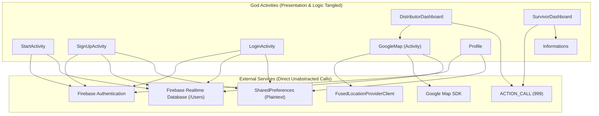
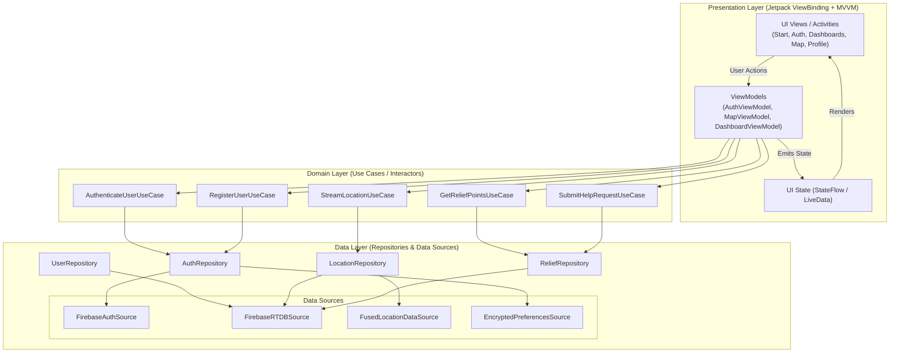

# 02 — Architecture Assessment & Modernization Strategy

## 1. Current Architecture Topology

The application currently operates as an unlayered, tightly-coupled client application where Android `Activity` classes serve as "God Objects", simultaneously managing UI rendering, view inflation, business logic, asynchronous networking, Firebase Realtime Database writes, GPS sensor polling, and unencrypted persistence.

## 2. Architectural Deficiencies & Coupling Analysis

1. **Tight Coupling to Android Framework & Firebase SDK**:
   - Zero separation of concerns. Every activity directly instantiates `FirebaseAuth.getInstance()` and `FirebaseDatabase.getInstance()`.
   - Business logic cannot be unit tested without running an Android device or heavily mocking Android framework static singletons.
2. **Missing Domain & Data Layers**:
   - No repository abstraction layer. Data serialization, node path strings (`"Users"`), and direct child manipulation (`database.child(userId).setValue(...)`) are duplicated in multiple activities.
3. **Fragile Lifecycle & Concurrency Model**:
   - Asynchronous Firebase listeners and Google Play Services location callbacks run without awareness of Activity lifecycle destruction. Rotating the device or pressing back causes memory leaks and `NullPointerException` crashes when updating UI elements of destroyed activities.
4. **Data Model Bleed & Security Invariants**:
   - `User.java` directly models both public profile data and private secrets (including plain-text password), which are serialized indiscriminately to Firebase Realtime Database.
5. **UI Code Duplication**:
   - The bottom navigation bar (`CardView` containing 4 `ImageView` widgets) is duplicated across 4 distinct layout XML files (`activity_distributor_dashboard.xml`, `activity_survivor_dashboard.xml`, `activity_google_map.xml`, `activity_informations.xml`) without code sharing or unified state management.

---

## 3. Target Modern Architecture (Clean Architecture + MVVM)

The evolutionary roadmap migrates the codebase toward the Modern Android Development (MAD) standard:

## 4. Key Architectural Decisions (ADR Summary)
- **ADR-001: Incremental MVVM Adoption**: Retain existing Activities while introducing Repositories in Phase 2 and ViewModels in Phase 3. Zero breaking rewrites.
- **ADR-002: ViewBinding Standardization**: Replace `findViewById` across all layouts to achieve compile-time null and type safety.
- **ADR-003: Safe Geospatial Architecture**: Decouple high-frequency GPS tracking updates from UI rendering. Stream location via a dedicated `LocationRepository` with adaptive throttling.
- **ADR-004: Clean Separation of User Profile and Authentication**: Remove credentials from `User` entity and manage auth tokens strictly via Firebase Auth session handlers.

