# 05 — Master 10-Phase Transformation Roadmap

---

## Program Overview & Phase Architecture

This master roadmap outlines the 10-phase engineering modernization plan to transform the Relief Distribution Android project from an early-stage monolithic prototype into a hardened, scalable, accessible, secure, and production-ready disaster response system.

```mermaid
flowchart LR
    P1["Phase 1\nIntelligence &\nFoundations"] --> P2["Phase 2\nArchitecture &\nModernization"]
    P2 --> P3["Phase 3\nBackend, APIs &\nData Engineering"]
    P3 --> P4["Phase 4\nFrontend & UX\nTransformation"]
    P4 --> P5["Phase 5\nAdvanced Features\n& Integrations"]
    P5 --> P6["Phase 6\nSecurity &\nPrivacy Hardening"]
    P6 --> P7["Phase 7\nPerformance &\nResilience"]
    P7 --> P8["Phase 8\nDevOps & CI/CD\nExcellence"]
    P8 --> P9["Phase 9\nComprehensive QA\n& Verification"]
    P9 --> P10["Phase 10\nSystem Certification\n& Release"]
```

---

## Detailed Phase Breakdown

### Phase 1: Project Intelligence, Foundations & Critical Fixes
- **Goals**: Full codebase reconnaissance, development environment setup (JDK 17, Android SDK 34), skill system installation, issue register formulation, and immediate P0/P1 fixes (API key leak, plain password storage removal, ScrollView overflow fix, dead clicks).
- **Dependencies**: None.
- **Affected Subsystems**: Build configurations, `User.java`, `SignUpActivity`, `LoginActivity`, `DistributorDashboard`, `SurvivorDashboard`, `res/values/strings.xml`, `res/layout/activity_sign_up.xml`.
- **Specialists Involved**: Principal Architect, Security Architect, Frontend Engineer, DevOps Engineer, QA Lead.
- **Relevant Skills**: `project-intelligence-audit`, `security-hardening`, `frontend-experience-engineering`, `devops-reliability`, `qa-verification`.
- **Deliverables**:
  - Full environment operational (JDK 17 + Android SDK 34).
  - Permanent skill system in `.agents/skills/` and rules in `.agents/rules/`.
  - P0 security fixes: removal of API key from `strings.xml`, elimination of plain passwords.
  - Form usability fix: `ScrollView` integration in `activity_sign_up.xml`.
  - Baseline metrics & upgrade control center in `docs/upgrade/`.
- **Acceptance Criteria**: `./gradlew.bat testDebugUnitTest` and `assembleDebug` exit with code 0; zero plaintext passwords in code or DB payloads.
- **Completion Gate**: Phase 1 Handoff Report verified and approved.

---

### Phase 2: Architecture Modernization & Clean MVVM Decoupling
- **Status**: **COMPLETED (2026-11-09)**
- **Goals**: Eliminate God-Activities; introduce Clean Architecture layers (Domain Use Cases, Data Repositories, ViewModels).
- **Dependencies**: Phase 1 completed.
- **Affected Subsystems**: All presentation classes (`com.example.reliefdistribution.*`), Jetpack ViewModel & Lifecycle integration.
- **Specialists Involved**: Principal Architect, Principal Backend Engineer, Principal Frontend Engineer.
- **Relevant Skills**: `system-architecture-review`, `frontend-experience-engineering`, `qa-verification`, `architecture-modernization`, `modular-codebase-engineering`, `safe-large-scale-refactoring`.
- **Deliverables**:
  - `AuthRepository`, `LocationRepository`, `FirebaseAuthRepository`, `FirebaseLocationRepository`.
  - `AuthViewModel`, `MapViewModel` with `LiveData` and `Resource<T>` envelopes.
  - Elimination of dead code `MainActivity.java` and `activity_main.xml`.
  - Renamed `GoogleMap.java` to `MapActivity.java` to resolve SDK class collision.
  - 100% ViewBinding adoption across all 9 Activities.
  - Modernized `LocationRequest.Builder` eliminating Play Services deprecation warnings.
- **Acceptance Criteria**: Activities contain zero direct Firebase SDK calls; all business logic unit testable on host JVM.
- **Verification Gates**:
  - Unit tests: 19/19 passed (100% pass rate).
  - Clean build: `assembleDebug` exit code 0 (`app-debug.apk`, 9.38 MB).
- **Completion Gate**: Phase 2 Architecture & Handoff Reports verified and approved.

---

### Phase 3: Backend, Data Engineering & Offline Resiliency
- **Status**: **COMPLETED (2026-11-09)**
- **Goals**: Standardize Firebase Realtime Database schema, add offline persistence, author security rules, enforce domain state machine, and build transaction safety.
- **Dependencies**: Phase 2 completed.
- **Affected Subsystems**: Data layer, Firebase RTDB rules, `ReliefApplication`, `network_security_config.xml`, `LocationTelemetry`, `ReliefRequest`, `FirebaseReliefRequestRepository`, `FirebaseConnectionRepository`.
- **Specialists Involved**: Senior Database Architect, Principal Backend Engineer, SRE Engineer, IoT Backend Architect.
- **Relevant Skills**: `backend-engineering`, `database-engineering`, `backend-api-engineering`, `database-integrity-engineering`, `domain-logic-verification`, `iot-cloud-backend-engineering`, `backend-resilience-and-observability`.
- **Deliverables**:
  - Global cold-boot offline disk persistence via `ReliefApplication.java` (`setPersistenceEnabled(true)`).
  - Version-controlled declarative `database.rules.json` with RBAC and regex schema validation.
  - Strict network transport security via `network_security_config.xml` (`cleartextTrafficPermitted="false"`).
  - Automated GPS telemetry disconnect teardown (`onDisconnect().removeValue()`).
  - Typed `LocationTelemetry` domain model with coordinate boundary enforcement.
  - `ReliefRequest` entity with forward-only lifecycle state machine and atomic `runTransaction` updates.
  - `ConnectionRepository` & `FirebaseConnectionRepository` tracking `/.info/connected`.
  - PII-safe logging utility `AppLogger.java` masking emails and phone numbers.
- **Verification Gates**:
  - Unit tests: **47/47 passed** (100% pass rate).
  - Clean build: `assembleDebug` exit code 0 (`app-debug.apk`, 9.38 MB).
- **Completion Gate**: Phase 3 Backend, Data Engineering & Handoff Reports verified and approved.

---

### Phase 4: Frontend Experience, Design System & Accessibility — COMPLETED
- **Goals**: Complete UI/UX redesign using Material Design 3, standardized design tokens, shared bottom navigation, responsive layouts, and WCAG AA accessibility.
- **Dependencies**: Phase 2 & 3 completed.
- **Status**: **Completed (100%)**
- **Affected Subsystems**: Layout XMLs, styles, themes, custom drawables, animations.
- **Specialists Involved**: Senior UI/UX Director, Principal Frontend Engineer, Accessibility Specialist, Motion Engineering Lead.
- **Relevant Skills**: `frontend-experience-engineering`, `creative-frontend-direction`, `advanced-motion-engineering`, `frontend-design-system`, `responsive-experience-engineering`, `accessibility-and-inclusive-ux`, `premium-interaction-design`, `frontend-performance-profiling`, `visual-regression-and-browser-qa`, `iot-dashboard-experience`.
- **Deliverables**:
  - Unified Material 3 theme (`themes.xml`, `colors.xml`, `dimens.xml`) with accessible semantic color & spacing tokens.
  - Non-blocking hardware-accelerated motion system (`fade_in.xml`, `slide_in_bottom.xml`, `scale_up.xml`).
  - Standardized reusable bottom navigation with minimum 48dp touch targets and ripple feedback.
  - Complete redesign of all 9 screens (`StartActivity`, `WelcomeActivity`, `LoginActivity`, `SignUpActivity`, `DistributorDashboard`, `SurvivorDashboard`, `MapActivity`, `Profile`, `Informations`).
  - Live Firebase connectivity status chip (`tvConnectionStatus`) on both role dashboards.
  - Dynamic user identity hub in `Profile` with computed initials circle avatar and role badge.
  - Comprehensive disaster preparedness knowledge hub in `Informations` (Cyclone, Flood, Earthquake, First Aid).
- **Verification Gates**:
  - Unit tests: **47/47 passed** (100% pass rate).
  - Compilation: `compileDebugSources` exit code 0.
  - Clean build: `assembleDebug` exit code 0 (`app-debug.apk`, 11.08 MB).
- **Completion Gate**: Phase 4 Visual UX audit, design system, and accessibility gate approved.

---

### Phase 5: Advanced Capabilities, Production AI, Automation & Integrations — COMPLETED
- **Goals**: Deliver complete vertical functional journeys for Survivors and Distributors, production AI triage intelligence, automated inventory state machines, resilient mobile edge IoT telemetry buffering, and turn-by-turn navigation integrations.
- **Dependencies**: Phase 3 & 4 completed.
- **Status**: **Completed (100% on 2026-11-09)**
- **Affected Subsystems**: `CreateReliefRequestActivity`, `MyReliefRequestsActivity`, `ManageRequestsActivity`, `InventoryManagementActivity`, `NotificationsActivity`, `ReliefTriageAdvisor`, `ReliefWorkflowAutomator`, `OfflineTelemetryBuffer`, `AndroidManifest.xml`.
- **Specialists Involved**: Principal Product Architect, Principal AI/ML Engineer, Principal Automation Architect, Principal IoT Systems Architect, Security Architect, Principal QA Engineer.
- **Relevant Skills**: `advanced-feature-engineering`, `production-ai-integration`, `agentic-workflow-engineering`, `intelligent-automation-engineering`, `ai-evaluation-and-guardrails`, `third-party-integration-engineering`, `iot-feature-engineering`, `feature-rollout-and-observability`, `full-stack-feature-qa`.
- **Deliverables**:
  - Survivor Aid Request Journey (`CreateReliefRequestActivity.java` & `activity_create_relief_request.xml`) with coordinate capture and AI urgency scoring.
  - Survivor Request Tracking Feed (`MyReliefRequestsActivity.java`) with color-coded status chips and cancellation controls.
  - Distributor Request Triage & Dispatch Dashboard (`ManageRequestsActivity.java`) with AI triage scoring, status tabs, and turn-by-turn Google Maps routing.
  - Relief Cargo & Inventory Depot (`InventoryManagementActivity.java` & `InventoryItem.java`) with threshold monitoring, category filtering, and atomic stock reservation.
  - Real-time Disaster Notification Stream (`NotificationsActivity.java` & `Notification.java`) with deep-linking data payloads.
  - Production AI Triage Advisor (`ReliefTriageAdvisor.java`) computing bound-clamped urgency scores $[0, 100]$ with contextual keyword extraction and deterministic guardrails.
  - Lifecycle Automation Engine (`ReliefWorkflowAutomator.java`) enforcing state transitions and atomic inventory reservations/deductions.
  - Mobile Edge IoT Telemetry Buffer (`OfflineTelemetryBuffer.java`) managing offline GPS breadcrumb queuing and battery-aware polling interval scaling.
- **Verification Gates**:
  - Unit tests: **70/70 passed** (100% pass rate across 16 test classes).
  - Compilation: `compileDebugJavaWithJavac` exit code 0 (zero errors).
  - Clean build: `assembleDebug` exit code 0 (`app-debug.apk`, 9.50 MB).
- **Completion Gate**: Phase 5 capability audit, AI architecture, automation engineering, and handoff approved.
- **Relevant Skills**: `backend-engineering`, `mobile-device-qa`, `system-architecture-review`.
- **Deliverables**:
  - Survivor "Ask for Help" submission form with rations and medical triage selectors.
  - Interactive map markers with custom icons for Relief Stations vs Active Distributors.
  - Firebase Cloud Messaging (FCM) notifications for critical disaster alerts.
  - Real-time donor/distributor ration inventory tally.
- **Acceptance Criteria**: Survivors can submit help requests and view them update in real-time on the distributor dashboard.
- **Completion Gate**: End-to-end aid request workflow verified.

---

### Phase 6: Security, Privacy & Compliance Hardening
- **Goals**: End-to-end security hardening, encrypted local storage, Firebase Security Rules enforcement, and OWASP MASVS compliance.
- **Dependencies**: Phase 5 completed.
- **Affected Subsystems**: Security layer, Jetpack Security (`EncryptedSharedPreferences`), ProGuard/R8.
- **Specialists Involved**: Senior Security Architect, Compliance and Privacy Engineer.
- **Relevant Skills**: `security-hardening`, `devops-reliability`.
- **Deliverables**:
  - `EncryptedSharedPreferences` for all local tokens.
  - Google Cloud Console API key restriction by package name and SHA-1 fingerprint.
  - Strict Firebase Security Rules verifying user authorization per path.
  - Network Security Configuration (`res/xml/network_security_config.xml`).
- **Acceptance Criteria**: Automated security audit reports zero high or critical vulnerabilities; all OWASP MASVS Level 1 requirements met.
- **Completion Gate**: Independent security audit sign-off.

---

### Phase 7: Performance, Battery & Scalability Engineering
- **Goals**: Adaptive location streaming, memory leak elimination, R8 minification, and APK payload optimization.
- **Dependencies**: Phase 6 completed.
- **Affected Subsystems**: Location engine, R8 configuration, image caching, memory management.
- **Specialists Involved**: Senior Performance Engineer, Mobile Platform Architect.
- **Relevant Skills**: `performance-optimization`, `mobile-device-qa`.
- **Deliverables**:
  - Adaptive GPS polling: dynamic interval based on speed and movement status.
  - R8 code shrinking and resource shrinking enabled (`isMinifyEnabled = true`).
  - ProGuard rules preserving Firebase reflection models.
  - APK size reduction target: < 8.0 MB.
- **Acceptance Criteria**: Zero memory leaks detected by LeakCanary; battery consumption reduced by > 50% during tracking.
- **Completion Gate**: Performance benchmark criteria satisfied.

---

### Phase 8: DevOps, CI/CD & Operational Excellence
- **Goals**: Automated GitHub Actions CI/CD pipelines, automated linting, test reports, release signing, and crash reporting.
- **Dependencies**: Phase 7 completed.
- **Affected Subsystems**: `.github/workflows/`, Gradle build types, Firebase Crashlytics.
- **Specialists Involved**: Senior DevOps / SRE Engineer, QA Automation Engineer.
- **Relevant Skills**: `devops-reliability`, `qa-verification`.
- **Deliverables**:
  - GitHub Actions workflow (`.github/workflows/android.yml`) running lint, tests, and build.
  - Firebase Crashlytics and Performance Monitoring integration.
  - Automated APK artifact upload on tagged releases.
- **Acceptance Criteria**: Clean CI build pass on every pull request within < 5 minutes.
- **Completion Gate**: CI/CD pipeline verified and documented.

---

### Phase 9: Comprehensive QA, Adversarial & Multi-Device Testing
- **Goals**: Comprehensive test automation suite: Unit, Repository integration, Robolectric, and Espresso UI flows.
- **Dependencies**: Phase 8 completed.
- **Affected Subsystems**: `src/test/`, `src/androidTest/`.
- **Specialists Involved**: Principal QA and Test Automation Engineer.
- **Relevant Skills**: `qa-verification`, `mobile-device-qa`.
- **Deliverables**:
  - Extensive unit test suite covering 80%+ of business logic.
  - Espresso UI tests for Auth, Map, and Emergency flows.
  - Adversarial testing: simulated network loss, invalid GPS data, corrupted database payloads.
- **Acceptance Criteria**: 100% of test suites pass deterministically; zero flaky tests.
- **Completion Gate**: QA certification sign-off.

---

### Phase 10: Final Overhaul, Production Certification & Release
- **Goals**: Full-system regression audit across Phases 1–9, documentation finalization, operational handoff, and production release readiness.
- **Dependencies**: All prior phases completed.
- **Affected Subsystems**: Entire project codebase, documentation, and release artifacts.
- **Specialists Involved**: Full Specialist Engineering Organization.
- **Relevant Skills**: All skills activated for final review.
- **Deliverables**:
  - Release-ready signed APK and Android App Bundle (`.aab`).
  - Complete Architecture Decision Record (ADR) catalog.
  - Developer onboarding and user operational manuals in `docs/`.
  - Final Engineering Certification Report.
- **Acceptance Criteria**: Production readiness checklist 100% fulfilled; all quality gates verified.
- **Completion Gate**: Program Completion Certificate issued.

