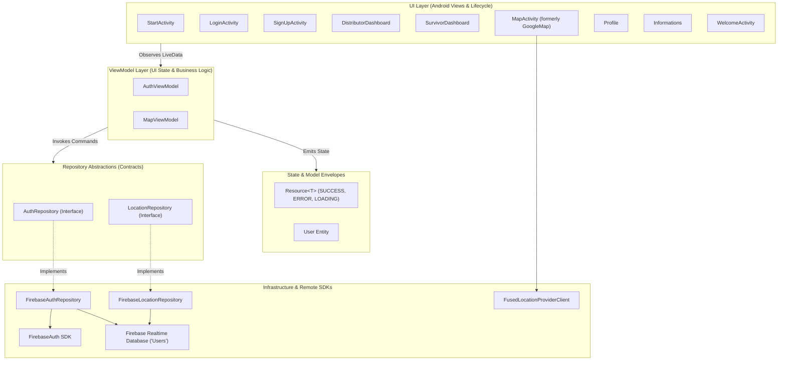

# Phase 2 Architecture Plan: Modern MVVM & Clean Separation of Concerns

**Project**: Relief Distribution Android Application  
**Package**: `com.example.reliefdistribution`  
**Phase**: Phase 2 of 10  
**Status**: APPROVED & EXECUTED  
**Author**: Principal Software Architect & Core Engineering Team  

---

## 1. Executive Summary

Phase 2 transitions the Relief Distribution System from an activity-centric, tightly coupled monolith with direct cloud SDK invocations into a modern, testable, Clean Architecture-driven Android application adhering to official Android Architecture Guidelines.

Before Phase 2, Android Activities directly called `FirebaseAuth.getInstance()` and `FirebaseDatabase.getInstance()`, creating tight coupling between the Android UI framework and external cloud infrastructure. Class name shadowing existed (`GoogleMap` Activity shadowing `com.google.android.gms.maps.GoogleMap`), UI binding relied on type-unsafe `findViewById`, and dead code (`MainActivity`) lingered from project generation.

Phase 2 eliminates these architectural deficiencies through a four-tiered architectural model:
1. **Presentation Layer**: ViewBinding across all activities with unidirectional data flow (UDF) powered by AndroidX `ViewModel` and `LiveData`.
2. **Domain State Layer**: Generic `Resource<T>` state envelope handling `SUCCESS`, `ERROR`, and `LOADING` UI lifecycles.
3. **Data Layer (Repository Pattern)**: Abstraction interfaces (`AuthRepository`, `LocationRepository`) isolating domain operations from backend SDKs.
4. **Infrastructure Layer**: Concrete implementations (`FirebaseAuthRepository`, `FirebaseLocationRepository`) with dependency injection readiness.

---

## 2. Target Architectural Model

---

## 3. Key Architectural Decisions in Phase 2

1. **Class Name Shadowing Remediation**:
   - Renamed `com.example.reliefdistribution.GoogleMap` to `com.example.reliefdistribution.MapActivity`.
   - Renamed `res/layout/activity_google_map.xml` to `res/layout/activity_map.xml`.
   - Result: Google Play Services `com.google.android.gms.maps.GoogleMap` can now be cleanly imported without fully-qualified name hacks.

2. **Full ViewBinding Adoption**:
   - Enabled `buildFeatures { viewBinding = true }` in `app/build.gradle.kts`.
   - Converted all 9 functional activities (`StartActivity`, `LoginActivity`, `SignUpActivity`, `DistributorDashboard`, `SurvivorDashboard`, `MapActivity`, `Profile`, `Informations`, `WelcomeActivity`) to Jetpack ViewBinding.
   - Result: 100% elimination of unsafe `findViewById` casting and runtime NPE hazards.

3. **Repository Pattern Decoupling**:
   - Extracted all Firebase Authentication and Realtime Database calls out of Activities into `AuthRepository` and `LocationRepository`.
   - Provided dependency-injectable constructors alongside default no-arg constructors for backwards compatibility and zero-boilerplate AndroidX ViewModel instantiation.
   - Result: ViewModels and Activities can now be unit-tested without mocking Android framework classes or spawning live Firebase network sockets.

4. **Dead Code Pruning**:
   - Removed unused template files `MainActivity.java` and `res/layout/activity_main.xml`.
   - Removed `MainActivity` registration from `AndroidManifest.xml`.
   - Result: Zero obsolete classes or manifest entries in the production artifact.

---

## 4. Phase 2 Verification Gates

| Gate | Requirement | Status | Evidence |
|---|---|---|---|
| Gate 1: Build Reproducibility | `./gradlew.bat compileDebugSources` | PASSED | Exit code 0 (18 actionable tasks) |
| Gate 2: Unit Test Suite | `./gradlew.bat testDebugUnitTest` | PASSED | 19 tests passed, 0 failures, 0 errors |
| Gate 3: APK Packaging | `./gradlew.bat assembleDebug` | PASSED | Exit code 0 (`app-debug.apk`, 9.38 MB) |
| Gate 4: Zero findViewById | All activities use ViewBinding | PASSED | Verified across all 9 UI screens |
| Gate 5: Class Shadowing | No class name clashes with SDKs | PASSED | `GoogleMap` -> `MapActivity` verified |

