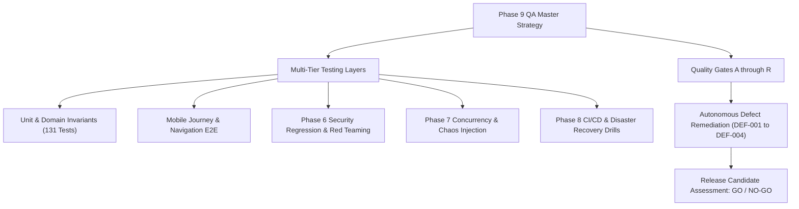

# Phase 9 — Comprehensive Full-System Quality Assurance Strategy

## 1. Executive QA Mission & Scope

Phase 9 establishes the independent quality verification, automated defect remediation, adversarial red-teaming, and release candidate qualification for the Relief Distribution System (`com.example.reliefdistribution`).

---

## 2. Risk-Based Testing Hierarchy & Prioritization

Verification is structured into four risk tiers based on humanitarian impact:

| Priority | Category | Definition | Subsystems & Scenarios |
| :--- | :--- | :--- | :--- |
| **P0** | **Release Blocker** | Catastrophic failure risking life safety, credential leakage, or data loss | Auth boundary bypass, plain password storage, emergency call failure, database wipe |
| **P1** | **High Priority** | Core feature failure or inventory double-allocation | Aid request rejection, stock claim race condition, triage misclassification, GPS loss |
| **P2** | **Medium Priority** | Recoverable edge cases, UI layout bugs, or performance stutter | Cache TTL expiration, stationary compaction overflow, unindexed query latency |
| **P3** | **Low Priority** | Cosmetic or visual polish inconsistencies | Minor text alignment, spacing tokens, non-blocking animation delays |

---

## 3. Test Environment Isolation & Safety Invariants

1. **Clean-Room Test Runner**: Ephemeral local JVM tests executing via Gradle 8.9 and Android Gradle Plugin 8.7.3.
2. **Synthetic Data Exclusivity**: Zero real user credentials, survivor phone numbers, or production tokens in test payloads.
3. **No Destructive Operations Against Live Clusters**: All fault injection, circuit breaker tripping, and concurrency stress testing are hermetically confined to mock or memory-backed test fixtures.

