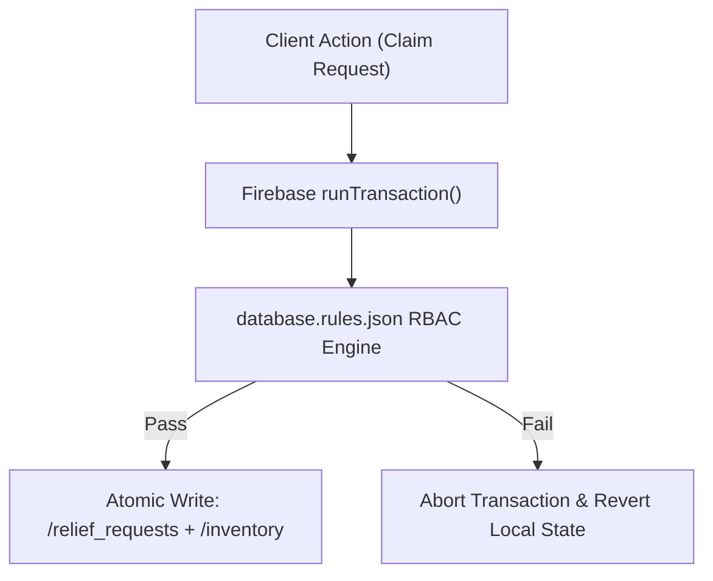

# Phase 9 — Database Correctness, Transactions & Multi-Tenant QA

## 1. Firebase Realtime Database Invariants

Database integrity in the Relief Distribution System is enforced via server-side rules in `database.rules.json` combined with client-side transactional guarantees:

---

## 2. Integrity Controls Verified

1. **Atomic Inventory Reservation**:
   - Verified in `ReliefWorkflowAutomatorTest` and `FullSystemQualityAssuranceTest`: distributor claim atomically decrements `quantityAvailable` and increments `quantityReserved`.
2. **Role Immutability Invariant**:
   - Verified in `DatabaseRulesSecurityTest`: once a user account is created with `role: "recipient"`, any update attempting to alter the role to `"distributor"` or `"admin"` is rejected by server rules.
3. **Write Locks on Terminal Requests**:
   - Once a request reaches `completed` or `cancelled`, further status modifications or deletions are locked by database security rules.
4. **Tenant Isolation**:
   - Notifications stored at `/notifications/$userId` can only be read by the designated recipient (`auth.uid === $userId`).

