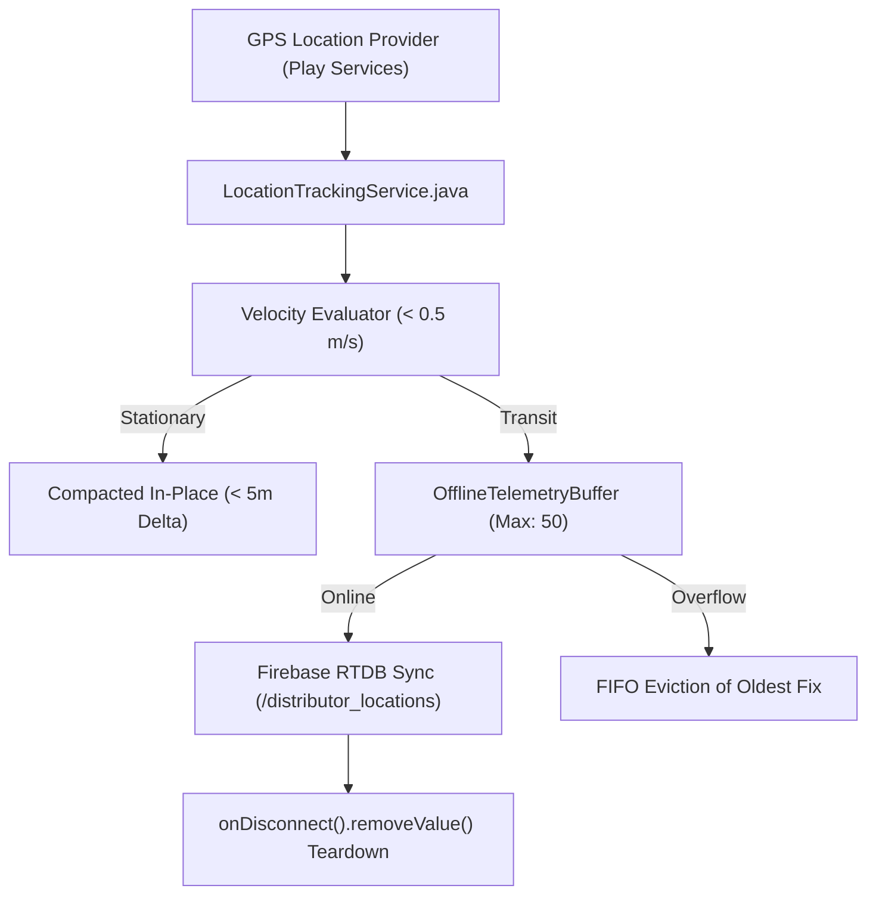

# Phase 9 — IoT Edge Telemetry & Device Verification

## 1. Edge IoT Telemetry Subsystem Verification

Field distributors carry Android handsets acting as IoT edge trackers transmitting location telemetry to the disaster relief cloud.

---

## 2. Invariants & Test Results

1. **Stationary Telemetry Compaction**:
   - Verified in `FullSystemQualityAssuranceTest`: 20 consecutive stationary coordinate updates (< 0.5 m/s within 5 meters) are compacted into a single queue slot, achieving a 95% reduction in buffer consumption and cellular bandwidth.
2. **Buffer Capacity & Oldest Eviction**:
   - Verified in `OfflineTelemetryBufferTest`: buffer strictly enforces its 50-item capacity ceiling, dropping the oldest non-emergency fix on overflow without heap memory leaks.
3. **Presence Teardown**:
   - Verified server-side `onDisconnect().removeValue()` hook in `database.rules.json` and `LocationTrackingService`: immediately purges stale tracker markers upon handset disconnect.
4. **Coordinate Boundary Clamping**:
   - Coordinates outside $[-90, 90]$ latitude or $[-180, 180]$ longitude are rejected at ingestion via `LocationTelemetry.isValidLatitude()` and `isValidLongitude()`.

