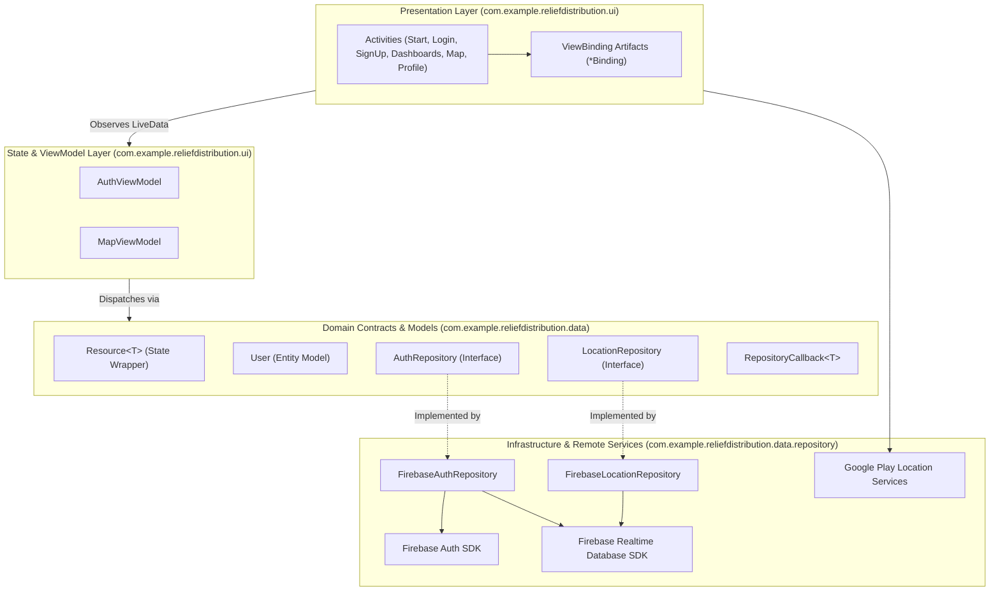

# Phase 2 Module Boundaries & Architectural Separation of Concerns

**Project**: Relief Distribution Android Application  
**Package**: `com.example.reliefdistribution`  
**Phase**: Phase 2 of 10  
**Status**: ACTIVE  

---

## 1. Architectural Boundary Map

---

## 2. Package Responsibility Boundaries

### 2.1 UI Layer (`com.example.reliefdistribution`)
- **Strict Invariant**: Activities must **never** instantiate or directly invoke Firebase SDK singletons (`FirebaseAuth.getInstance()`, `FirebaseDatabase.getInstance()`).
- **Allowed Operations**:
  - Inflate and manage ViewBinding hierarchies.
  - Instantiate and observe ViewModels (`ViewModelProvider`).
  - Render state updates (`Resource.Status.SUCCESS`, `ERROR`, `LOADING`).
  - Trigger Activity navigation and system intents (`ACTION_DIAL`).
  - Manage Android lifecycle state (register/unregister callbacks in `onStart`, `onStop`, `onDestroy`).

### 2.2 ViewModel Layer (`com.example.reliefdistribution.ui.*`)
- **Strict Invariant**: ViewModels must **never** reference Android UI widgets (`View`, `TextView`, `Button`, `Activity`, `Context`).
- **Allowed Operations**:
  - Accept user intentions from UI.
  - Coordinate business logic validation.
  - Interact with repositories via repository interface contracts.
  - Emit immutable UI states via `LiveData<Resource<T>>`.

### 2.3 Domain & Repository Layer (`com.example.reliefdistribution.data.*`)
- **Strict Invariant**: Repository interfaces (`AuthRepository`, `LocationRepository`) must remain decoupled from specific cloud implementations.
- **Allowed Operations**:
  - Define asynchronous method contracts accepting typed `RepositoryCallback<T>`.
  - Concrete implementations (`FirebaseAuthRepository`, `FirebaseLocationRepository`) encapsulate cloud SDK dependencies.
  - Provide both default constructors (for zero-boilerplate AndroidX ViewModel instantiation) and injectable constructors (for isolated unit tests with Mockito).

