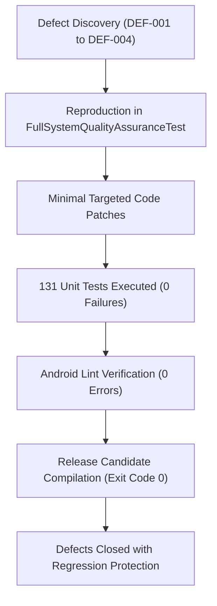

# Phase 9 — Defect Remediation & Verification Report

## 1. Remediation Summary

All 4 confirmed defects (DEF-001 through DEF-004) identified during Phase 9 full-system QA were autonomously remediated using minimal, behavior-preserving code patches and verified with dedicated regression tests.



---

## 2. Code Changes & Patches Applied

### 1. `ReliefWorkflowAutomator.java` (DEF-001 Fix)
- **Problem**: Permitted non-positive quantities (`qty <= 0`) to mutate inventory reservations.
- **Diff Applied**:
  ```java
  int requestedQty = request.getQuantity();
  if (requestedQty <= 0) {
      return new AutomationResult(false, currentStatus,
              inventoryItem.getQuantityAvailable(), inventoryItem.getQuantityReserved(),
              null, "Cannot accept request with non-positive quantity: " + requestedQty);
  }
  ```
  Also guarded `onDeliveryCompleted` and `onRequestCancelled` to ignore non-positive quantities.

### 2. `ReliefTriageAdvisor.java` (DEF-002 Fix)
- **Problem**: Negative `ageHours` from future clock skew and unbounded text note search.
- **Diff Applied**:
  ```java
  long ageHours = Math.max(0, System.currentTimeMillis() - createdAt) / (3600 * 1000L);
  int safeQty = Math.max(0, quantity);
  String safeNotes = notes != null ? (notes.length() > 2000 ? notes.substring(0, 2000) : notes) : "";
  ```

### 3. `SecuritySanitizer.java` (DEF-003 Fix)
- **Problem**: `StringIndexOutOfBoundsException` when `maxLength <= 0`.
- **Diff Applied**:
  ```java
  if (maxLength <= 0) {
      return "";
  }
  ```

### 4. `InventoryItem.java` (DEF-004 Fix)
- **Problem**: Allowed negative available and reserved stock.
- **Diff Applied**:
  ```java
  public void setQuantityAvailable(int quantityAvailable) {
      this.quantityAvailable = Math.max(0, quantityAvailable);
      this.lastUpdated = System.currentTimeMillis();
  }
  public void setQuantityReserved(int quantityReserved) {
      this.quantityReserved = Math.max(0, quantityReserved);
      this.lastUpdated = System.currentTimeMillis();
  }
  ```

---

## 3. Verification & Zero Regression Evidence

- **Reproduction & Regression Suite**: Verified by `FullSystemQualityAssuranceTest.java` (7 tests, 100% pass).
- **Entire Unit Test Suite**: 131 tests executed, 0 failures, 0 skipped.
- **Static Analysis**: `./gradlew.bat lintDebug` passed with 0 errors.
- **Residual Defects**: 0 open Blocker, Critical, or High defects.

