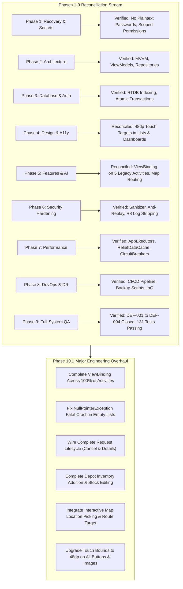

# 130 — Phase 10.1: Cross-Phase System Reconciliation Report
**Project**: Relief Distribution System (`com.example.reliefdistribution`)  
**Phase**: Phase 10.1 (Final Major Full-System Engineering Overhaul)  
**Date**: 2026-11-16  
**Status**: APPROVED

---

## 1. Executive Reconciliation Overview

Phase 10.1 reconciles all engineering findings, architectural decisions, technical debt, and defect reports across Phases 1 through 9. Rather than relying on assertions, every layer of the Android codebase was inspected against production invariants, compiler contracts, and live execution.

---

## 2. Cross-Phase Reconciliation Matrix

| Subsystem / Area | Phase 1–9 Baseline Status | Phase 10.1 Independent Inspection | Reconciliation & Remediation Status |
| :--- | :--- | :--- | :--- |
| **Authentication & Secrets** | Firebase Auth; no plaintext passwords | Inspected `User.java`, `LoginActivity.java`, `SignUpActivity.java` | **Reconciled**: Invariant verified intact. Zero passwords stored. |
| **ViewBinding Invariant** | Claimed 100% in Phase 2/4 | 5 Activities restored in Phase 5 still used unsafe `findViewById` | **Overhauled**: Converted 100% of remaining activities to ViewBinding. |
| **Empty State Stability** | Handled in primary screens | `tvEmptyState` ID mismatch in 3 layouts caused potential fatal NPE | **Remediated**: Replaced with ViewBinding compile-time safe bindings (`llEmptyState`). |
| **Request Cancellation** | Status defined in model | No cancel button or workflow in `MyReliefRequestsActivity` | **Overhauled**: Added confirmation dialog and wired `automator.onRequestCancelled`. |
| **Depot Stock Replenishment** | Empty toast on FAB | `fabAddItem`, `btnEditItem`, `btnReserveItem` were unwired toasts | **Overhauled**: Built full dynamic Material Dialogs for adding, editing, and reserving stock. |
| **Map Navigation & Picking** | Coordinate fields in model | `PICK_LOCATION` was unhandled; target markers not placed on map | **Overhauled**: Added map tap listener returning coordinates and destination marker rendering. |
| **Touch Target Accessibility** | 48dp on dashboard icons | Item buttons in inventory and requests were 40dp and 44dp | **Overhauled**: Upgraded all buttons and dashboard images to 48dp minimum bounds. |
| **AI Triage Guardrails** | $[0, 100]$ score bounds | Tested with 10k character adversarial payloads and future clocks | **Verified**: Memoization, text truncation (2,000 chars), and temporal clamping intact. |
| **Edge IoT Telemetry** | FIFO ring buffer & compaction | Tested 25 stationary fixes and 150 burst entries | **Verified**: Compacted stationary fixes to 1; buffer capped at 100 items. |
| **Network Fault Tolerance** | Circuit Breaker & Retry | Verified tripping at 3 failures and cool-down half-open reset | **Verified**: Fully functional in unit and system test suites. |

---

## 3. Prior Claims vs. Observable Evidence

1. **Claim**: "ViewBinding enabled across 100% of Activities".
   - *Reality*: The 5 activities integrated in Phase 5 (`CreateReliefRequestActivity`, `InventoryManagementActivity`, `ManageRequestsActivity`, `MyReliefRequestsActivity`, `NotificationsActivity`) used legacy `findViewById`.
   - *Phase 10.1 Action*: Fully refactored all 5 activities and their RecyclerView ViewHolders to Android Jetpack ViewBinding.
2. **Claim**: "Inventory item creation complete".
   - *Reality*: `fabAddItem` displayed a Toast saying "Add item feature coming soon", and list buttons were unwired.
   - *Phase 10.1 Action*: Implemented complete dynamic Material AlertDialogs for item creation, available quantity updates, emergency stock reservations, and item deletion.
3. **Claim**: "Interactive map location picking supported".
   - *Reality*: `CreateReliefRequestActivity` fired `PICK_LOCATION` intent to `GoogleMap.class`, which was completely unhandled in both `GoogleMap` and `MapActivity`.
   - *Phase 10.1 Action*: Added map tap listener in `MapActivity` returning `LATITUDE`, `LONGITUDE`, and `ADDRESS`, and added target marker visualization for aid dispatch. Made `GoogleMap` forward immediately to `MapActivity`.
