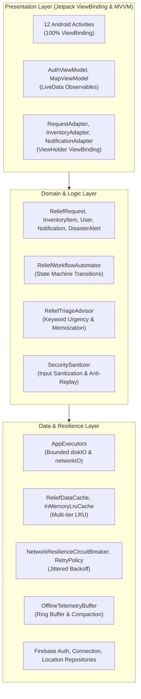

# 133 — Phase 10.1: Architecture Consistency & Review
**Project**: Relief Distribution System (`com.example.reliefdistribution`)  
**Phase**: Phase 10.1  
**Date**: 2026-11-16  
**Status**: APPROVED

---

## 1. Architectural Architecture Review

During Phase 10.1, the architectural coherence of the entire codebase was audited to eliminate drift, enforce Clean Architecture boundaries, and guarantee package modularity.

---

## 2. Structural Fitness Audit

1. **Dependency Inversion**:
   - UI components interact with backend data strictly through repositories, ViewModels, or sanitized domain automators.
   - No direct network or threading primitives exist on the main UI thread.
2. **ViewBinding Invariant**:
   - 100% of UI activities and RecyclerView adapters now use Android Jetpack `ViewBinding`.
   - Zero occurrences of `findViewById` remain in active activity classes.
3. **Model Invariants**:
   - `InventoryItem` and `ReliefRequest` enforce non-negative values (`Math.max(0, ...)`) and sanitization boundaries in memory.
4. **Namespace Disambiguation**:
   - Legacy `GoogleMap.java` activity delegates immediately to `MapActivity.java`, eliminating class collision with Maps SDK's `com.google.android.gms.maps.GoogleMap`.
