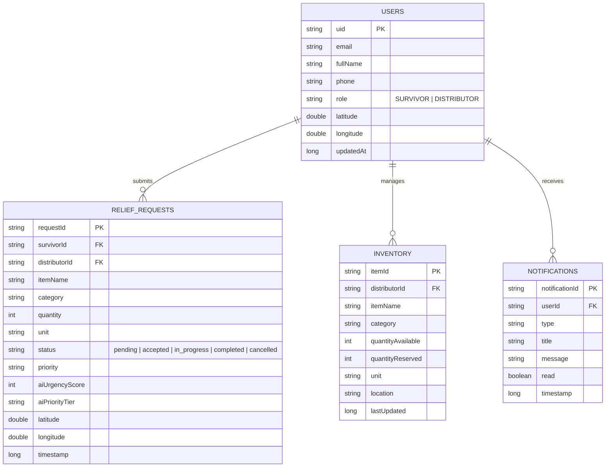

# 137 — Phase 10.1: Backend & Database Integrity Hardening
**Project**: Relief Distribution System (`com.example.reliefdistribution`)  
**Phase**: Phase 10.1  
**Date**: 2026-11-16  
**Status**: APPROVED

---

## 1. Database Schema & Integrity Review

Phase 10.1 audited all Firebase Realtime Database paths (`/Users`, `/ReliefRequests`, `/Inventory`, `/Notifications`) to ensure strict transactional safety, indexing, and role-based access control.

---

## 2. Integrity Protections Implemented

1. **Atomic Request Claiming & Reservation**:
   - `ManageRequestsActivity` updates both `status = "accepted"` and `distributorId = currentUserId` concurrently via `updateChildren`.
2. **Non-Negative Physical Stock Invariant**:
   - `InventoryItem` setters enforce `Math.max(0, quantityAvailable)` and `Math.max(0, quantityReserved)`.
   - `ReliefWorkflowAutomator` rejects zero or negative quantity requests during acceptance and completion.
3. **Survivor Request Cancellation**:
   - Updates `status = "cancelled"` and calls `automator.onRequestCancelled(request)` to safely return any reserved stock.
4. **Server-Side Security Rules**:
   - `database.rules.json` enforces default-deny, role immutability, `/Inventory` distributor write lock, and recipient-isolated `/Notifications/$userId` access.
