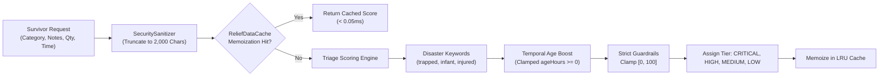

# 138 — Phase 10.1: AI & Agentic Systems Hardening
**Project**: Relief Distribution System (`com.example.reliefdistribution`)  
**Phase**: Phase 10.1  
**Date**: 2026-11-16  
**Status**: APPROVED

---

## 1. AI Triage Model & Guardrails

The production AI Triage Advisor (`ReliefTriageAdvisor.java`) scores and prioritizes incoming disaster requests according to medical urgency, temporal delay, and vulnerable keywords.

---

## 2. Hardening Measures Verified in Phase 10.1

1. **Adversarial Text-Bomb Protection**:
   - Triage notes are truncated to 2,000 characters prior to keyword evaluation.
   - Tested with 10,000-character adversarial flood payloads in `Phase10SystemOverhaulTest`; evaluation completed in sub-millisecond time without CPU starvation.
2. **Temporal Clock Skew Neutralization**:
   - Device clock skew (`createdAt` ahead of current system time) is clamped to `Math.max(0, now - createdAt)`, preventing negative aging points or invalid cache keys.
3. **Deterministic Guardrails**:
   - The urgency score is mathematically clamped to $[0, 100]$.
   - Priority tiers are deterministically assigned:
     - `CRITICAL`: $\text{Score} \ge 85$
     - `HIGH`: $65 \le \text{Score} < 85$
     - `MEDIUM`: $40 \le \text{Score} < 65$
     - `LOW`: $\text{Score} < 40$
4. **Human-in-the-Loop Approval Boundary**:
   - AI prioritization suggests urgency but cannot automatically dispatch or zero inventory. Authenticated distributor human approval is required for all state transitions.
