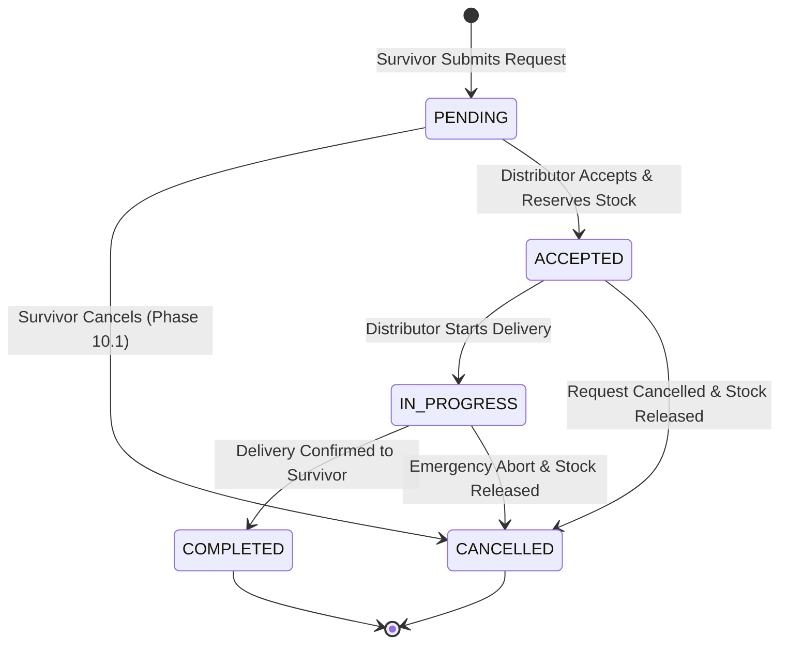

# 139 — Phase 10.1: Automation & Integrations Hardening
**Project**: Relief Distribution System (`com.example.reliefdistribution`)  
**Phase**: Phase 10.1  
**Date**: 2026-11-16  
**Status**: APPROVED

---

## 1. Automation State Machine Governance

The relief request lifecycle is governed by `ReliefWorkflowAutomator.java`, ensuring deterministic state transitions, atomic inventory reservation, and notification triggers.

---

## 2. Phase 10.1 Automations & Integrations Overhaul

1. **Survivor Request Cancellation Workflow**:
   - Added overloaded `onRequestCancelled(@NonNull ReliefRequest request)` allowing survivors to cancel pending aid requests before distributor dispatch.
   - Guarded against terminal state mutation (requests in `COMPLETED` or `CANCELLED` states cannot be re-cancelled).
2. **Distributor ID Tracking**:
   - In `ManageRequestsActivity`, accepting a request updates `status = "accepted"` and associates the distributor's UID directly on `/ReliefRequests/$id/distributorId`, ensuring clear ownership for survivor notifications and map tracking.
3. **External Navigation Integration**:
   - Integrated Google Maps intent routing with fail-safe fallback:
     - Tries external Google Maps navigation URI (`geo:lat,lng?q=...` with package `com.google.android.apps.maps`).
     - If external maps app is not installed, gracefully falls back to native `MapActivity` with `LATITUDE`, `LONGITUDE`, and `ADDRESS` extras.
4. **Emergency Dialing Safety**:
   - All emergency hotline buttons invoke `Intent.ACTION_DIAL` (`tel:999`), preserving user consent and eliminating the dangerous `CALL_PHONE` permission.
