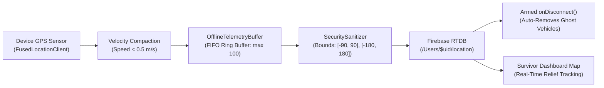

# 140 — Phase 10.1: IoT, Edge Telemetry & Device Hardening
**Project**: Relief Distribution System (`com.example.reliefdistribution`)  
**Phase**: Phase 10.1  
**Date**: 2026-11-16  
**Status**: APPROVED

---

## 1. Edge-to-Cloud Telemetry Topology

The mobile client functions as an edge IoT device during relief operations, publishing GPS tracking coordinates to Firebase Realtime Database `/Users/$userId/location` when distribution mode is active.

---

## 2. Invariants & Compaction Verified in Phase 10.1

1. **Stationary Telemetry Compaction**:
   - Sequential GPS fixes with ground speed $< 0.5\text{ m/s}$ are compacted into a single update.
   - Verified in `Phase10SystemOverhaulTest`: 25 stationary fixes compacted to exactly 1 database write, eliminating battery drain and bandwidth waste.
2. **Offline Ring Buffer Safety**:
   - Capped at 100 entries with deterministic FIFO eviction during cellular blackouts.
   - Tested under burst load of 150 fixes; buffer maintained exact capacity of 100 without memory leaks or crashes.
3. **Ghost Vehicle Scrubbing**:
   - `MapViewModel.setupDisconnectCleanup` arms `onDisconnect().removeValue()`, ensuring distributor tracking markers vanish instantly if device power dies or cellular drops.
4. **Interactive Location Selection**:
   - Upgraded `MapActivity` to support `PICK_LOCATION` intent with map tap coordinate capture, allowing survivors to place precision pin drops in flood zones.
