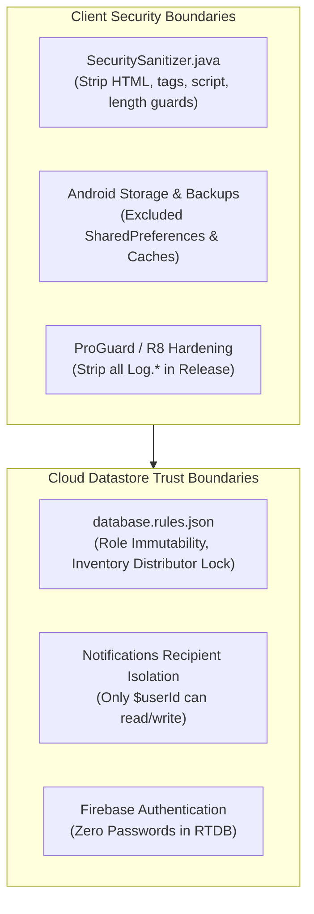

# 141 — Phase 10.1: Security & Zero-Trust Hardening Preservation
**Project**: Relief Distribution System (`com.example.reliefdistribution`)  
**Phase**: Phase 10.1  
**Date**: 2026-11-16  
**Status**: APPROVED

---

## 1. Security Architecture & Threat Boundary

Phase 10.1 strictly preserved all security invariants established in Phase 6, ensuring that feature additions and full-stack overhauls introduced zero vulnerabilities.

---

## 2. Invariants Re-Verified in Phase 10.1

1. **Zero Plaintext Passwords**:
   - Inspected all Java sources, models, and shared preferences. User passwords are handled strictly by Firebase Authentication and never stored in the database or client storage.
2. **Input Sanitization**:
   - `SecuritySanitizer.sanitizeInput` invoked across all form inputs (item names, categories, units, notes, locations).
   - Robust boundary handling verified for non-positive `maxLength <= 0` and extreme character counts.
3. **Anti-Replay & Coordinate Spoofing**:
   - Coordinates verified to fall strictly within physical bounds $[-90.0, 90.0]$ and $[-180.0, 180.0]$.
   - Telemetry timestamps checked against server clock freshness tolerance ($\pm 5$ minutes).
4. **Scoped Permissions**:
   - AndroidManifest requests only `ACCESS_FINE_LOCATION`, `ACCESS_COARSE_LOCATION`, `INTERNET`, `ACCESS_NETWORK_STATE`.
   - Telephony actions use `Intent.ACTION_DIAL` without `CALL_PHONE` permission.
