# 143 — Phase 10.1: DevOps, CI/CD & Operational Excellence
**Project**: Relief Distribution System (`com.example.reliefdistribution`)  
**Phase**: Phase 10.1  
**Date**: 2026-11-16  
**Status**: APPROVED

---

## 1. CI/CD & Pipeline Governance

The automated GitHub Actions workflow (`.github/workflows/android.yml`) established in Phase 8 was audited to confirm build repeatability, least-privilege token permissions, and test coverage.

```mermaid
flowchart LR
    Push["Git Commit Push<br/>(main / release/*)"] --> Concurrency["Concurrency Control<br/>cancel-in-progress: true"]
    Concurrency --> CI["GitHub Actions Runner<br/>(ubuntu-latest, Java 17)"]
    CI --> Lint["Lint Debug<br/>(./gradlew lintDebug)"]
    Lint --> Test["Unit Test Suite<br/>(138 tests, 100% pass)"]
    Test --> Assemble["Assemble Debug APK<br/>(./gradlew assembleDebug)"]
    Assemble --> Digest["SHA-256 Attestation<br/>Generate .sha256 artifact"]
    Digest --> Archive["Archive Artifacts<br/>(APK & Test Reports)"]
```

---

## 2. Platform & DR Invariants Verified

1. **Pipeline Token Least Privilege**:
   - Explicit `permissions: contents: read` blocks unauthorized token escalation on pull requests.
2. **Build Artifact Provenance**:
   - Release candidate APK (`app-debug.apk`) is attested with cryptographic SHA-256 digest `F7972F4311F6D5D6BB4261EEC575ECF79362837BBDAA61733FDF830380F62687`.
3. **Declarative Disaster Recovery**:
   - Automated disaster snapshot scripts (`scripts/Backup-FirebaseRtdb.ps1`, `scripts/backup_firebase_rtdb.py`) maintain Recovery Point Objective (RPO) $\le 1\text{ hour}$ and Recovery Time Objective (RTO) $\le 30\text{ minutes}$.
4. **Declarative Cloud Datastore Rules**:
   - Infrastructure as Code specifications (`firebase.json`, `.firebaserc`, `database.rules.json`) eliminate configuration drift across environments.
