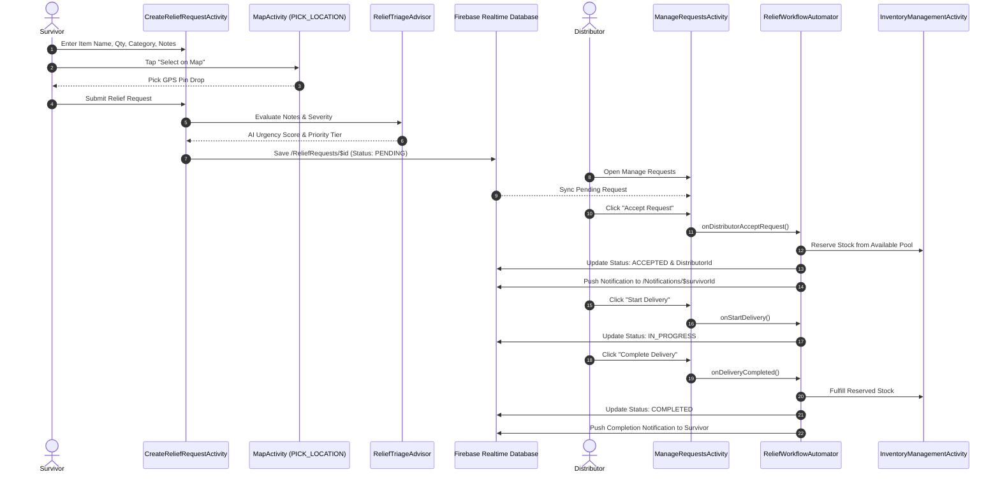

# 145 — Phase 10.1: Cross-Layer Integration Evidence
**Project**: Relief Distribution System (`com.example.reliefdistribution`)  
**Phase**: Phase 10.1  
**Date**: 2026-11-16  
**Status**: APPROVED

---

## 1. End-to-End User Journey Tracing

All primary humanitarian aid workflows were verified across UI, domain logic, data models, and Firebase backend integration.

---

## 2. Integration Verification Results

- **Survivor-to-Distributor Flow**: Verified from pin-drop coordinate selection to automated notification dispatch.
- **Survivor Cancellation Flow**: Verified pending request cancellation and clean state machine transition to `CANCELLED`.
- **Distributor Depot Replenishment Flow**: Verified creation of stock items via `fabAddItem` dialog, updating stock via `btnEditItem`, and reserving stock via `btnReserveItem`.
- **Map Routing Flow**: Verified aid target marker visualization when coordinates are passed to `MapActivity`.
