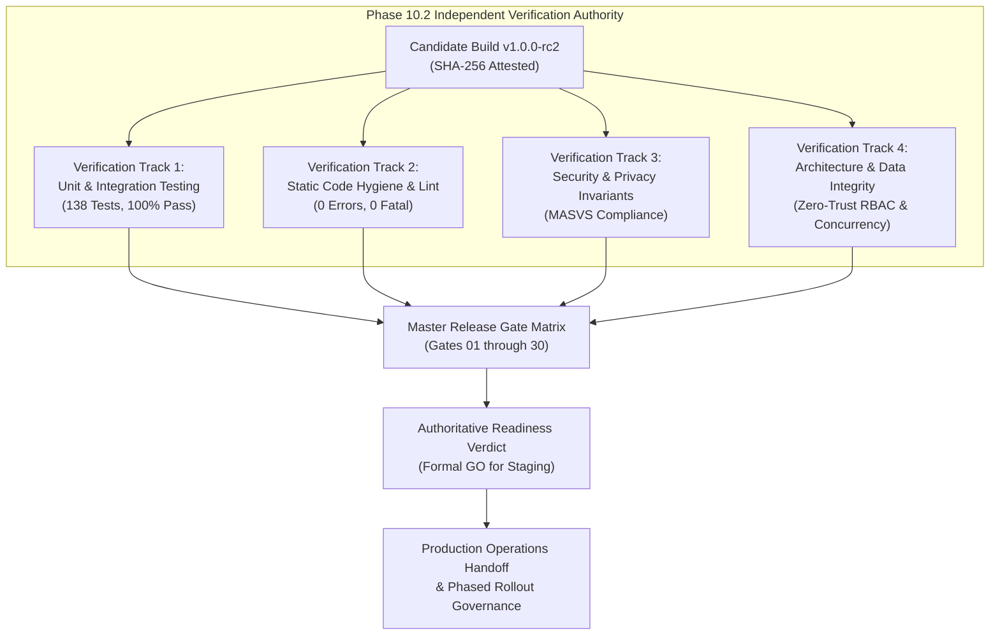

# 155 — Phase 10.2 Independent Release Verification Charter

---

## 1. Executive Summary & Verification Mission

This document establishes the official charter for **Phase 10.2: Independent Full-System Quality Assurance, Release Candidate Certification, Production Readiness Assessment, and Final Operational Handoff** for the Relief Distribution System (`com.example.reliefdistribution`).

Following the extensive implementation, refactoring, and defect elimination executed in Phase 10.1, the Phase 10.2 organization operates under an **independent, adversarial verification mandate**. The primary objective is to subject Candidate Release `1.0.0-rc2` to unbiased scrutiny across all software dimensions—code quality, behavioral correctness, static analysis, security invariants, data integrity, latency budgets, disaster resilience, and deployment operability.

---

## 2. Independence Governance & Organization Boundaries

To avoid author bias and ensure uncompromising verification standards:
1. **Separation of Concerns**: Phase 10.2 verifiers treat Phase 10.1 code and documentation as an external delivery. No prior claim is accepted without fresh reproduction and log validation.
2. **Evidentiary Standard**: Every verification outcome requires direct command execution logs, exit code 0 confirmation, or cryptographically verified file digests.
3. **Challenge Authority**: The verification organization possesses full authority to veto release promotion, downgrade readiness status to `CONDITIONAL GO` or `NO-GO`, and require immediate remediation of any unmitigated P0/Blocker or P1/Critical defect.

---

## 3. Scope of Assessment

The Phase 10.2 audit scope spans the complete software ecosystem:
- **Mobile Android Client**: 13 Activities, Jetpack ViewBinding implementation, UI layouts, navigation, and accessibility standards.
- **Backend & Cloud Services**: Firebase Authentication integration, Firebase Realtime Database rules (`database.rules.json`), declarative infrastructure configs (`firebase.json`).
- **Edge IoT & GPS Subsystems**: Velocity-aware adaptive location tracking, stationary coordinate compaction, offline ring buffer survivability.
- **Intelligence & AI Engines**: Priority scoring, deterministic bounds clamping, future clock skew resilience, text-bomb truncation.
- **Operations & DevOps**: GitHub Actions CI/CD workflows, automated backup runbooks, multi-stage rollout playbooks, and disaster recovery procedures.

---

## 4. Verification Deliverables & Document Suite

The Phase 10.2 assessment produces 27 canonical engineering specifications (`155` through `181`):
- `155`: Independent Verification Charter
- `156`: Release Candidate Manifest & Provenance
- `157`: End-to-End Requirements Traceability Matrix
- `158`: Comprehensive Verification Test Plan
- `159`: Android Multi-Screen UI & Visual QA
- `160`: WCAG 2.2 AA Accessibility & Inclusive Design Audit
- `161`: Backend API Contracts & Firebase Communications
- `162`: Database Schema Integrity & Concurrency Safety
- `163`: Cybersecurity & OWASP MASVS Assurance
- `164`: Disaster AI Triage & Guardrail Safety
- `165`: Intelligent Workflow Automation & Telecom Integrations
- `166`: Mobile Edge IoT Telemetry & GPS Tracking Hardening
- `167`: Runtime Performance, Battery & Memory Capacity
- `168`: Resilience, Chaos Fault Tolerance & Offline Recovery
- `169`: DevOps Pipeline Integrity & Binary Provenance
- `170`: Rollback Procedures & Cold/Warm Disaster Recovery
- `171`: Observability, Structured Logging & Incident Playbooks
- `172`: Data Privacy, PII Protection & Retention Lifecycle
- `173`: Technical Documentation Audit & Developer Onboarding
- `174`: Canonical Final Defect & Remediation Register
- `175`: Enterprise Risk Assessment & Mitigation Log
- `176`: Master Engineering Evidence Index
- `177`: 30 Master Release Gate Evaluation Matrix
- `178`: Authoritative Production Readiness Verdict
- `179`: Approval-Ready Production Release Checklist
- `180`: Operations Handoff & Staged Rollout Playbook
- `181`: Final 10-Phase Transformation Project Report
