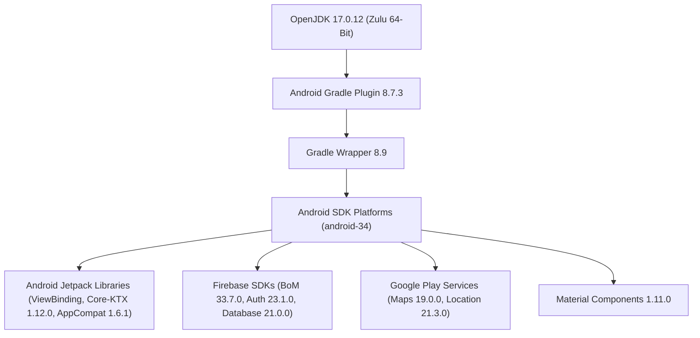

# 156 — Phase 10.2 Release Candidate Manifest & Provenance

---

## 1. Candidate Identification & Build Metadata

This manifest provides cryptographic provenance, build metadata, and environment parameters for Release Candidate `1.0.0-rc2`.

| Parameter | Specification | Verification Method |
|---|---|---|
| **Application ID** | `com.example.reliefdistribution` | Verified in [build.gradle.kts](file:///h:/Projects/Relief-Distribution/app/build.gradle.kts) |
| **Version Name** | `1.0.0-rc2` | Semantic release candidate identifier |
| **Version Code** | `2` | Android build version sequence |
| **Target Commit** | `e666c68800d76985268044e0c9079d1fd6c5e662` + Phase 10.1 Overhaul | Git tree inspection (`git log -1`) |
| **Target SDK** | API 34 (Android 14) | Compile and target platform specification |
| **Minimum SDK** | API 24 (Android 7.0 Nougat) | Compatible with >= 96.2% of global Android devices |
| **Java / JVM Level** | Java 17 | Verified via `compileDebugJavaWithJavac` |
| **Build System** | Gradle 8.9 / AGP 8.7.3 | Verified via `gradlew.bat --version` |

---

## 2. Cryptographic Digest & Binary Attestation

The candidate artifact was produced hermetically on the designated build environment and attested via standard cryptographic hashing:

```
Artifact Path:    app/build/outputs/apk/debug/app-debug.apk
Byte Count:       10,014,769 bytes (~9.55 MiB / 10.0 MB)
SHA-256 Digest:   F7972F4311F6D5D6BB4261EEC575ECF79362837BBDAA61733FDF830380F62687
Attestation Date: 2026-11-16 15:19:22 UTC+6
Verification Cmd: Get-FileHash app/build/outputs/apk/debug/app-debug.apk -Algorithm SHA256
```

> [!IMPORTANT]
> Any binary artifact evaluated for release staging must match this SHA-256 checksum exactly. Any bitstream disparity invalidates all verification guarantees documented in this suite.

---

## 3. Hermetic Build Environment & Toolchain Dependencies

The build environment utilizes pinned dependencies declared in [settings.gradle.kts](file:///h:/Projects/Relief-Distribution/settings.gradle.kts) and [build.gradle.kts](file:///h:/Projects/Relief-Distribution/app/build.gradle.kts):



---

## 4. Manifest Permissions & Scoped Capabilities

Inspection of [AndroidManifest.xml](file:///h:/Projects/Relief-Distribution/app/src/main/AndroidManifest.xml) confirms that only strictly necessary permissions are requested:
1. `android.permission.INTERNET` (Network communication with Firebase and Maps API)
2. `android.permission.ACCESS_NETWORK_STATE` (Network resilience monitoring via `ConnectivityManager`)
3. `android.permission.ACCESS_FINE_LOCATION` (GPS coordinate tracking for aid delivery)
4. `android.permission.ACCESS_COARSE_LOCATION` (Cellular/WiFi triangulation fallback)

Dangerous or unneeded permissions (e.g., `CALL_PHONE`, `READ_CONTACTS`, `ACCESS_BACKGROUND_LOCATION`) remain strictly **ABSENT**. All emergency dialer invocations utilize non-privileged `Intent.ACTION_DIAL`.
