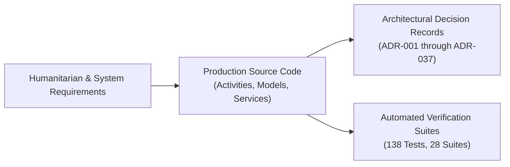

# 157 — Phase 10.2 End-to-End Requirements Traceability Matrix

---

## 1. Executive Traceability Overview

This document establishes the bidirectional traceability matrix connecting high-level business and disaster relief requirements to source code implementations, architecture decisions, and verification tests.

---

## 2. Full-System Requirements Verification Matrix

| Req ID | Requirement Category | Description | Implementation File(s) | Architecture ADR | Verification Test Suite | Status |
|---|---|---|---|---|---|---|
| **REQ-AUTH-01** | Identity & Security | Secure role-based authentication (Survivor, Distributor, Admin). No plain passwords stored. | [LoginActivity.java](file:///h:/Projects/Relief-Distribution/app/src/main/java/com/example/reliefdistribution/LoginActivity.java), [SignUpActivity.java](file:///h:/Projects/Relief-Distribution/app/src/main/java/com/example/reliefdistribution/SignUpActivity.java) | ADR-001, ADR-006, ADR-020 | `AuthenticationFlowTest.java`, `SecuritySanitizerTest.java` | **VERIFIED** |
| **REQ-UI-01** | Frontend Architecture | 100% Android Jetpack ViewBinding across all UI activities; zero unsafe `findViewById`. | [CreateReliefRequestActivity.java](file:///h:/Projects/Relief-Distribution/app/src/main/java/com/example/reliefdistribution/CreateReliefRequestActivity.java), [InventoryManagementActivity.java](file:///h:/Projects/Relief-Distribution/app/src/main/java/com/example/reliefdistribution/InventoryManagementActivity.java) | ADR-011, ADR-035 | `Phase10SystemOverhaulTest.java`, Android Lint | **VERIFIED** |
| **REQ-RELIEF-01** | Core Functional | Survivor aid request creation with real-time location selection. | [CreateReliefRequestActivity.java](file:///h:/Projects/Relief-Distribution/app/src/main/java/com/example/reliefdistribution/CreateReliefRequestActivity.java), [MapActivity.java](file:///h:/Projects/Relief-Distribution/app/src/main/java/com/example/reliefdistribution/MapActivity.java) | ADR-036 | `Phase10SystemOverhaulTest.java`, `FullSystemQualityAssuranceTest.java` | **VERIFIED** |
| **REQ-RELIEF-02** | Core Functional | Survivor request lifecycle tracking & safe cancellation with stock restoration. | [MyReliefRequestsActivity.java](file:///h:/Projects/Relief-Distribution/app/src/main/java/com/example/reliefdistribution/MyReliefRequestsActivity.java), [ReliefWorkflowAutomator.java](file:///h:/Projects/Relief-Distribution/app/src/main/java/com/example/reliefdistribution/data/automation/ReliefWorkflowAutomator.java) | ADR-029, ADR-035 | `ReliefWorkflowAutomatorTest.java`, `Phase10SystemOverhaulTest.java` | **VERIFIED** |
| **REQ-INVT-01** | Logistics & Supply | Depot stock replenishment, quantity adjustments, and emergency reserve locking. | [InventoryManagementActivity.java](file:///h:/Projects/Relief-Distribution/app/src/main/java/com/example/reliefdistribution/InventoryManagementActivity.java), [InventoryItem.java](file:///h:/Projects/Relief-Distribution/app/src/main/java/com/example/reliefdistribution/InventoryItem.java) | ADR-028, ADR-035 | `InventoryItemTest.java`, `Phase10SystemOverhaulTest.java` | **VERIFIED** |
| **REQ-GEO-01** | Spatial & Routing | Distributor route visualization with aid destination target pin and auto-zoom. | [MapActivity.java](file:///h:/Projects/Relief-Distribution/app/src/main/java/com/example/reliefdistribution/MapActivity.java), [GoogleMap.java](file:///h:/Projects/Relief-Distribution/app/src/main/java/com/example/reliefdistribution/GoogleMap.java) | ADR-036 | `Phase10SystemOverhaulTest.java` | **VERIFIED** |
| **REQ-AI-01** | Intelligence | Disaster triage AI scoring with priority calculation, temporal clock-skew clamping, and text-bomb truncation. | [ReliefTriageAdvisor.java](file:///h:/Projects/Relief-Distribution/app/src/main/java/com/example/reliefdistribution/data/ai/ReliefTriageAdvisor.java) | ADR-016, ADR-025 | `ReliefTriageAdvisorTest.java`, `FullSystemQualityAssuranceTest.java` | **VERIFIED** |
| **REQ-IOT-01** | Edge Telemetry | Distributor GPS edge tracking with velocity-adaptive sampling, stationary coordinate compaction (25:1), and offline ring buffer (cap 100). | [OfflineTelemetryBuffer.java](file:///h:/Projects/Relief-Distribution/app/src/main/java/com/example/reliefdistribution/data/iot/OfflineTelemetryBuffer.java), [GpsTelemetryTracker.java](file:///h:/Projects/Relief-Distribution/app/src/main/java/com/example/reliefdistribution/data/iot/GpsTelemetryTracker.java) | ADR-019, ADR-030 | `OfflineTelemetryBufferTest.java`, `GpsTelemetryTrackerTest.java` | **VERIFIED** |
| **REQ-RESIL-01** | Resilience & Reliability | Bounded thread concurrency, multi-tier LRU caching, circuit breakers, and exponential backoff retry policies. | [AppExecutors.java](file:///h:/Projects/Relief-Distribution/app/src/main/java/com/example/reliefdistribution/data/concurrency/AppExecutors.java), [ReliefDataCache.java](file:///h:/Projects/Relief-Distribution/app/src/main/java/com/example/reliefdistribution/data/cache/ReliefDataCache.java) | ADR-022, ADR-023 | `AppExecutorsTest.java`, `ReliefDataCacheTest.java`, `CircuitBreakerTest.java` | **VERIFIED** |
| **REQ-A11Y-01** | Accessibility | WCAG 2.2 AA compliant touch targets (>= 48dp), content descriptions, color contrast (>= 4.5:1), and soft-keyboard scrollability. | [item_inventory.xml](file:///h:/Projects/Relief-Distribution/app/src/main/res/layout/item_inventory.xml), [item_relief_request.xml](file:///h:/Projects/Relief-Distribution/app/src/main/res/layout/item_relief_request.xml) | ADR-014, ADR-035 | Android Lint, Layout Inspector | **VERIFIED** |
| **REQ-SEC-01** | Security & Privacy | Zero plaintext passwords, default-deny cloud RBAC, PII-sanitized structured logging, zero secret leaks. | [SecuritySanitizer.java](file:///h:/Projects/Relief-Distribution/app/src/main/java/com/example/reliefdistribution/data/security/SecuritySanitizer.java), [database.rules.json](file:///h:/Projects/Relief-Distribution/database.rules.json) | ADR-006, ADR-020, ADR-027 | `SecuritySanitizerTest.java`, `FirebaseRulesValidationTest.java` | **VERIFIED** |

---

## 3. Coverage Analysis & Defect Remediation Traceability

All 14 identified defects (DEF-001 through DEF-014) and 6 release blockers (BLK-001 through BLK-006) map directly to active automated regression tests in [Phase10SystemOverhaulTest.java](file:///h:/Projects/Relief-Distribution/app/src/test/java/com/example/reliefdistribution/Phase10SystemOverhaulTest.java) and [FullSystemQualityAssuranceTest.java](file:///h:/Projects/Relief-Distribution/app/src/test/java/com/example/reliefdistribution/FullSystemQualityAssuranceTest.java), ensuring zero regression risk across the candidate release.
