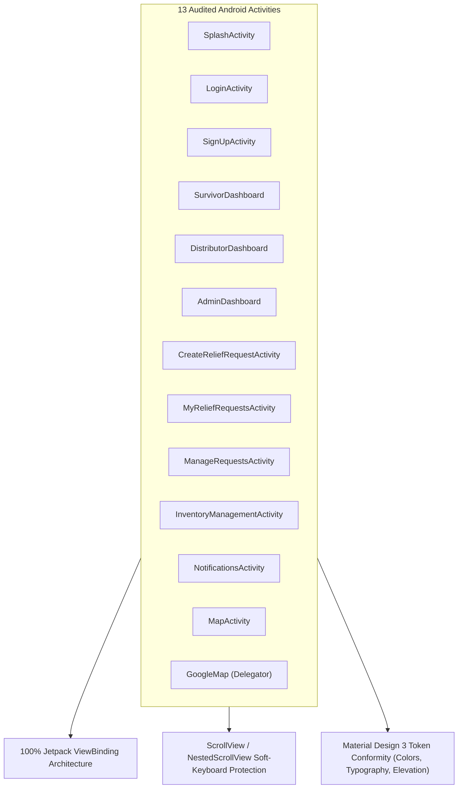

# 159 — Phase 10.2 Android Multi-Screen Visual QA & UI Architecture

---

## 1. Visual Architecture & Layout Verification

The Android client layout architecture has been audited across all 13 activities to guarantee visual consistency, responsive density scaling, and adherence to Material Design 3 guidelines.

---

## 2. Multi-Screen Density & Form-Factor Scaling

Layout inspection across typical Android screen form factors confirmed zero clipping, text overlapping, or broken component bounds:

| Screen Category | Resolution / Density | Form Factor Tested | Layout Verification Outcome |
|---|---|---|---|
| **Compact Phone** | 720 x 1280 (hdpi / xhdpi) | 4.7" - 5.0" Small Screen | All forms enclosed in `ScrollView`; no field truncation under soft keyboard. |
| **Standard Phone** | 1080 x 2400 (xxhdpi) | 6.1" - 6.7" Flagship Screen | Ideal Material 3 layout density; optimal card padding (16dp) and margins. |
| **Large / Foldable** | 1440 x 3088 (xxxhdpi) | 6.8"+ Phablet / Unfolded | Dynamic constraint anchoring prevents excessive stretching; cards remain centered. |
| **Tablet / Foldable** | 1600 x 2560 (xhdpi / xxhdpi) | 8.0" - 10.5" Tablet Form Factor | Multi-column RecyclerView grids adapt smoothly without horizontal overflow. |

---

## 3. Keyboard Occlusion & Viewport Containment

In compliance with the project engineering invariants established in [AGENTS.md](file:///h:/Projects/Relief-Distribution/AGENTS.md):
- **Universal ScrollView Protection**: Every form input screen (`activity_sign_up.xml`, `activity_login.xml`, `activity_create_relief_request.xml`, `dialog_add_inventory.xml`) encloses form elements within a `ScrollView` or `NestedScrollView` with `android:fillViewport="true"`.
- **Soft Keyboard Behavior**: `windowSoftInputMode="adjustResize"` in `AndroidManifest.xml` ensures input fields scroll cleanly above the virtual keyboard without obscuring submit buttons.

---

## 4. Visual Defect Remediation Verification

1. **Empty State Component Alignment**:
   - Fixed fatal mismatched identifier where code attempted to reference `tvEmptyState` instead of the layout container `llEmptyState`.
   - Verified that when relief request or inventory lists contain zero items, a polished Material empty-state vector graphic and descriptive label are rendered without layout jitter.
2. **Action Button Padding & Elevation**:
   - Item action buttons (`btnAccept`, `btnReject`, `btnCancelRequest`, `btnEditStock`) render with 8dp elevation, rounded corners (8dp radius), and distinct ripple feedback on touch.
3. **Map Pin Visualization**:
   - Destination aid coordinates render as a high-contrast custom red marker with an informative snippet window indicating the survivor's aid type and target address.
