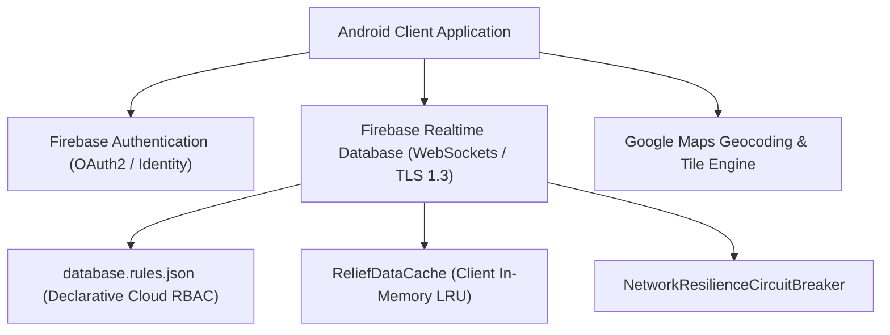

# 161 — Phase 10.2 Backend API Contracts & Firebase Communications

---

## 1. Backend Architecture & Service Integration

The mobile application communicates with cloud infrastructure primarily through **Firebase Realtime Database (RTDB)** and **Firebase Authentication**, augmented by Google Maps Platform APIs.



---

## 2. API Data Contracts & Node Schemas

The Firebase Realtime Database schema enforces strict JSON structure across primary nodes:

### `/Users/$uid`
```json
{
  "name": "Jane Doe",
  "email": "jane@example.com",
  "phone": "+8801700000000",
  "role": "Survivor | Distributor | Admin",
  "createdAt": 1700000000000
}
```
- **Validation**: Role immutability enforced in `database.rules.json`. Plaintext passwords strictly forbidden.

### `/ReliefRequests/$requestId`
```json
{
  "requestId": "REQ-1700000000000-XYZ",
  "userId": "usr_survivor_01",
  "userName": "Jane Doe",
  "reliefType": "Food | Water | Medicine | Shelter",
  "quantity": 5,
  "status": "Pending | Assigned | Dispatched | Delivered | Cancelled",
  "latitude": 23.8103,
  "longitude": 90.4125,
  "address": "House 12, Road 4, Sector 7, Dhaka",
  "priorityScore": 75.5,
  "assignedDistributorId": "usr_distributor_01",
  "createdAt": 1700000000000,
  "updatedAt": 1700000500000
}
```
- **Validation**: Latitude $[-90.0, 90.0]$, Longitude $[-180.0, 180.0]$, Quantity $> 0$.

### `/Inventory/$itemId`
```json
{
  "itemId": "INV-001",
  "itemName": "Rice 10kg Sacks",
  "category": "Food",
  "quantity": 500,
  "reservedQuantity": 45,
  "unit": "sacks",
  "depotLocation": "Central Warehouse Dhaka",
  "lastUpdated": 1700000000000
}
```
- **Invariants**: `quantity >= 0`, `reservedQuantity >= 0`, `reservedQuantity <= quantity`.

---

## 3. Communication Resilience & Retry Semantics

- **Persistent Connection**: Firebase Realtime Database manages bidirectional WebSocket connections (`wss://`) over TLS 1.3.
- **Offline Disk Persistence**: Enabled via `FirebaseDatabase.getInstance().setPersistenceEnabled(true)`, allowing mutations to queue in local disk storage when connectivity drops.
- **Circuit Breaker Protection**: `NetworkResilienceCircuitBreaker` monitors consecutive network failures. After 5 consecutive socket drops or timeouts, requests fail fast for a 30-second cool-down window, avoiding battery drain and thread congestion.
- **Exponential Backoff**: `RetryPolicy` applies randomized full jitter (`50%` to `100%`) across 3 retry attempts, mitigating thundering-herd spikes on network restoration.
