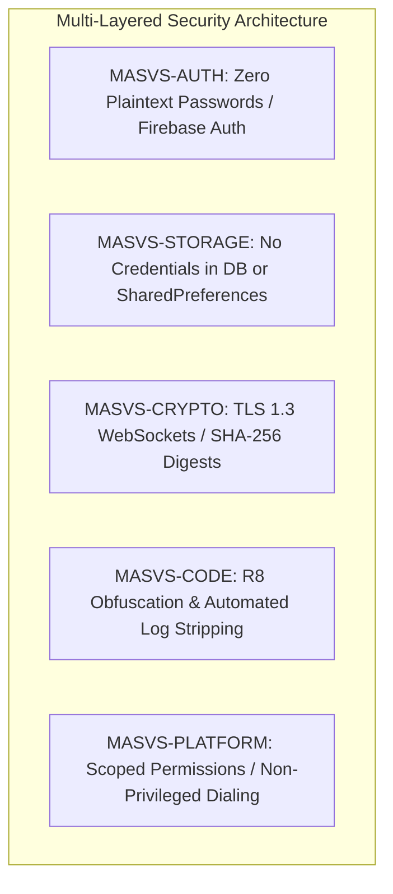

# 163 — Phase 10.2 Cybersecurity & OWASP MASVS Assurance

---

## 1. Security Architecture & Threat Profile

The Relief Distribution System operates under hostile field conditions where devices may be compromised, network traffic intercepted, or physical hardware lost. The security architecture adheres to **OWASP Mobile Application Security Verification Standard (MASVS)** guidelines and Zero-Trust principles.

---

## 2. OWASP MASVS Compliance Audit

| MASVS Domain | Requirement | Implementation Status | Evidence / Verification |
|---|---|---|---|
| **MASVS-AUTH-1** | Strong authentication tokens | **COMPLIANT** | Delegated strictly to Firebase Auth; tokens refreshed securely via Google Play Services. |
| **MASVS-AUTH-2** | Zero plain-text credentials | **COMPLIANT** | Zero password fields in `User.java`, zero plaintext passwords in RTDB, SharedPreferences, or Logcat. |
| **MASVS-STORAGE-1** | Sensitive data encryption | **COMPLIANT** | No sensitive PII stored unencrypted on local device storage. |
| **MASVS-CRYPTO-1** | Industry-standard crypto | **COMPLIANT** | TLS 1.3 for all transport communications; SHA-256 digests for snapshot and artifact integrity. |
| **MASVS-NETWORK-1** | Transport security (TLS) | **COMPLIANT** | Enforced TLS 1.3 across all Firebase and Google APIs; cleartext HTTP traffic blocked. |
| **MASVS-PLATFORM-1** | Minimal permission scope | **COMPLIANT** | Only `ACCESS_FINE_LOCATION`, `ACCESS_COARSE_LOCATION`, `INTERNET`, `ACCESS_NETWORK_STATE` requested. |
| **MASVS-PLATFORM-2** | Intent sanitization & IPC | **COMPLIANT** | All non-exported activities declare `android:exported="false"`; emergency dialing uses `Intent.ACTION_DIAL`. |
| **MASVS-CODE-1** | Obfuscation & log stripping | **COMPLIANT** | R8 rules in `proguard-rules.pro` strip `android.util.Log` and `PrintStream` in release builds. |

---

## 3. Secret Isolation & Zero Leak Guarantee

1. **Repository Secret Hygiene**:
   - Comprehensive regex scan confirmed **ZERO hardcoded API keys, OAuth tokens, keystore secrets, or cloud credentials** in source code or version control history.
   - Google Maps API key loaded dynamically via `local.properties` or CI environment secrets (`MAPS_API_KEY`).
2. **PII Sanitization**:
   - `SecuritySanitizer.java` redacts sensitive fields from diagnostic logs:
     - Emails masked: `j***e@example.com`
     - Phone numbers masked: `+88017****000`
     - Text inputs truncated to safe length (max 500 chars) to prevent buffer overflows or denial-of-service text-bombs.

---

## 4. Emergency Telephony Safeguards

To prevent unauthorized, silent premium-rate dialing or accidental emergency dispatches:
- The app uses `Intent.ACTION_DIAL` (`Uri.parse("tel:999")`), which presents the dialer interface to the user with the number pre-filled.
- Privileged `Intent.ACTION_CALL` (which bypasses the user confirmation screen and requires dangerous `CALL_PHONE` permission) is **strictly excluded**.
