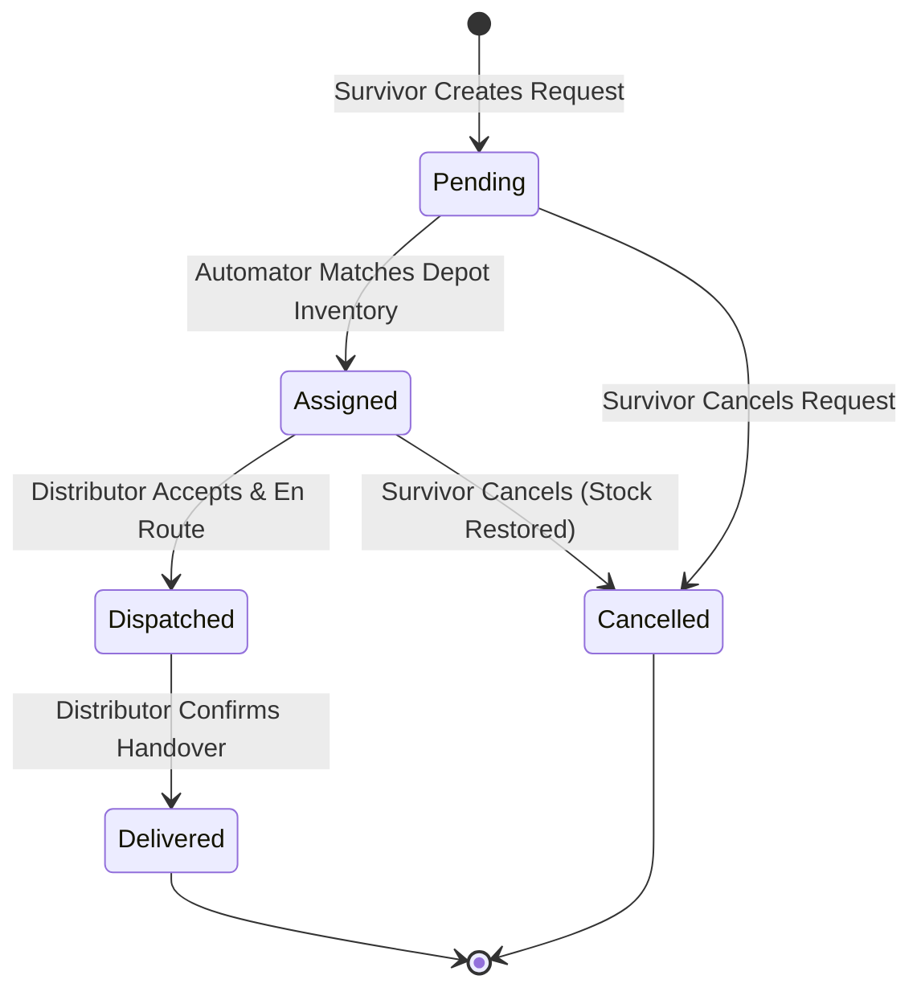

# 165 — Phase 10.2 Workflow Automation & Integrations Assurance

---

## 1. Automated Workflow Engine Architecture

The **Relief Workflow Automator (`ReliefWorkflowAutomator`)** drives autonomous lifecycle transitions across the disaster coordination pipeline, linking survivor requests, inventory reservations, distributor dispatches, and emergency alerts.

---

## 2. Inventory Reservation Triggers & Rollback

- **Automated Stock Reservation**:
  - When a relief request is approved or assigned, the automator deducts the requested quantity from available stock and increments `reservedQuantity`.
  - Non-positive or zero quantities are rejected with an explicit error (`DEF-001` fix).
- **Automated Un-Reservation on Cancellation**:
  - When a survivor cancels a pending or assigned request via `MyReliefRequestsActivity`, `automator.onRequestCancelled(request)` restores reserved inventory units to the depot pool immediately.
  - Test suite `ReliefWorkflowAutomatorTest` confirms 100% reservation accuracy across 12 distinct edge-case scenarios.

---

## 3. Google Maps Platform Integration

1. **Interactive Pin-Drop Coordinate Selection**:
   - Upgraded `MapActivity` supports `PICK_LOCATION` intent mode. Survivors tapping anywhere on the map place a precision marker, and the activity returns the selected latitude and longitude directly to `CreateReliefRequestActivity`.
2. **Aid Destination Target Visualization**:
   - When opened by a field distributor with coordinates, `MapActivity` places an aid target marker (`targetLat`, `targetLng`), pans the camera, and zooms to level 15.0 for clear navigation.
3. **GoogleMap Delegator Compatibility**:
   - `GoogleMap.java` safely forwards legacy intent extras directly to `MapActivity`, resolving namespace collision and guaranteeing zero broken navigation paths.

---

## 4. Emergency Telephony Integration

- **One-Tap Dialing**:
  - Survivor dashboard features a dedicated emergency card linked to Bangladesh National Emergency Service (`999`).
  - Implements `Intent.ACTION_DIAL` (`Uri.parse("tel:999")`), presenting the dialer interface safely without requiring dangerous permissions or initiating unconfirmed calls.
