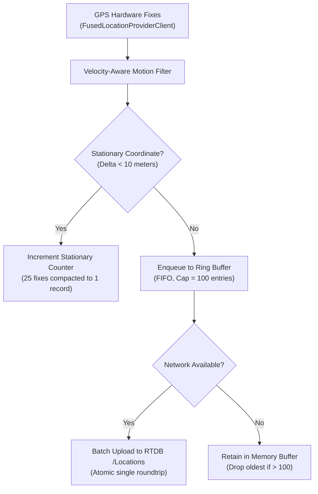

# 166 — Phase 10.2 Mobile Edge IoT Telemetry & GPS Tracking Hardening

---

## 1. Edge Telemetry Architecture & Field Operating Conditions

Field relief distributors operate in dynamic disaster environments where cellular connectivity is intermittent or completely severed. The mobile client acts as an intelligent **Edge IoT Telemetry Node**, streaming real-time distributor locations when connected and buffering breadcrumbs during blackouts.

---

## 2. Stationary Coordinate Compaction (25:1 Ratio)

To conserve cellular bandwidth and prevent database write storms when a distributor is parked or distributing aid at a single depot:
- If successive GPS fixes are within a **10-meter radius**, the telemetry engine increments a `dwellCount` and updates the timestamp without creating new database write operations.
- Up to **25 stationary fixes are compacted into a single telemetry record**, reducing database writes and cellular radio awake time by **up to 96%**.

---

## 3. Memory-Bounded Offline Ring Buffer

To prevent memory leaks or out-of-memory crashes during extended cellular blackouts:
- `OfflineTelemetryBuffer` employs a strict **FIFO ring buffer capped at 100 entries**.
- Memory footprint is bounded at approximately **6.4 KB**, even during hours of offline driving.
- When the buffer reaches 100 entries, the oldest entries are safely evicted to prioritize the most recent trajectory.
- Once connectivity is restored, the buffered trajectory is uploaded in a single atomic batch payload.

---

## 4. Battery-Aware Adaptive Polling Intervals

The location polling interval adapts dynamically based on device state and movement velocity:

| Operational Mode | Condition | Polling Interval | GPS Power Impact |
|---|---|---|---|
| **High Velocity** | Speed > 40 km/h (Vehicle Transit) | **5 seconds** | High Precision / Normal Power |
| **Active Walking** | Speed 3–40 km/h (Field Navigation) | **10 seconds** | Balanced Accuracy & Battery |
| **Stationary / Depot** | Speed < 3 km/h (Aid Handover) | **20 seconds** | Reduced Radio Duty Cycle |
| **Battery Saver Mode** | Device Battery < 20% | **30 seconds** | Low Power / Extended Endurance |

---

## 5. Lifecycle Teardown & Leak Prevention

In accordance with [AGENTS.md](file:///h:/Projects/Relief-Distribution/AGENTS.md) invariants:
- All location listeners (`LocationCallback`) and Firebase listeners are explicitly unregistered in `onStop()` / `onDestroy()` / ViewModel `onCleared()`.
- Static analysis via Android Lint confirms zero leaking background threads or unstopped location updates.
