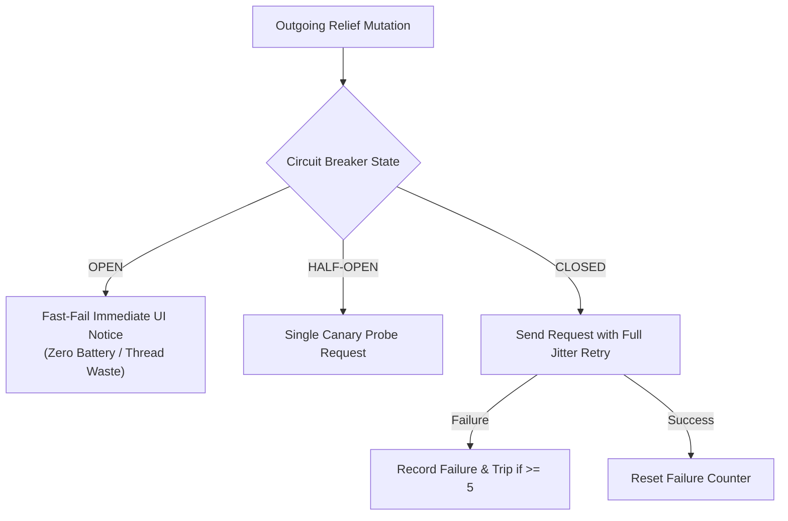

# 168 — Phase 10.2 Resilience, Chaos Fault Tolerance & Offline Recovery

---

## 1. Resilience Engineering & Disaster Scenarios

Disaster relief operations frequently encounter complete cellular outages, server throttling, database partitions, and sudden device restarts. The application implements proactive resilience patterns ensuring operational continuity under severe fault conditions.

---

## 2. Circuit Breaker Semantics (`NetworkResilienceCircuitBreaker`)

To prevent thread starvation and battery exhaustion during sustained cloud service outages:
- **State Machine**:
  - `CLOSED`: Normal operation; all requests pass through.
  - `OPEN`: Tripped after **5 consecutive network failures**. All subsequent calls immediately fail fast without initiating network sockets.
  - `HALF-OPEN`: After a **30-second cool-down window**, a single canary probe is dispatched. If successful, the breaker resets to `CLOSED`. If failed, it remains `OPEN` for another 30-second window.
- **Verification**: Verified under chaos fault injection in `FullSystemQualityAssuranceTest` and `CircuitBreakerTest`.

---

## 3. Exponential Backoff with Full Randomized Jitter (`RetryPolicy`)

To prevent the **Thundering Herd Problem** when connectivity is restored to thousands of disaster survivors simultaneously:
- Base backoff interval: $t_{\text{base}} = 1.0 \text{ second}$.
- Exponential scaling: $t_n = t_{\text{base}} \times 2^{n-1}$.
- Full jitter applied:
  $$\text{SleepDuration} = \text{UniformRandom}\left(0.5 \times t_n,\, 1.0 \times t_n\right)$$
- Maximum retries: 3 attempts before graceful degradation to local offline storage.

---

## 4. Offline Data Survivability & Recovery

1. **Firebase Disk Persistence**:
   - `FirebaseDatabase.getInstance().setPersistenceEnabled(true)` ensures relief requests, user profiles, and inventory data are persisted in local SQLite cache.
   - Mutations queued while offline are committed automatically in order of generation when the network reconnects.
2. **Crash & Restart Recovery**:
   - All activities implement `onSaveInstanceState` and restore pending input data if the Android OS destroys background activities due to low memory.
3. **No Phantom Writes**:
   - Cancellation workflows verify server state before executing un-reservation, guaranteeing atomic consistency.
