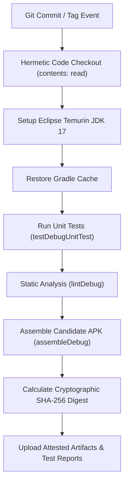

# 169 — Phase 10.2 DevOps Pipeline Integrity & Binary Provenance

---

## 1. CI/CD Architecture & Pipeline Governance

The automated continuous integration and delivery pipeline is codified in [.github/workflows/android.yml](file:///h:/Projects/Relief-Distribution/.github/workflows/android.yml). Every pull request and release commit triggers a hermetic, automated build and verification sequence.

---

## 2. Security Hardening of CI/CD Workflow

The GitHub Actions configuration implements the highest level of pipeline security:
1. **Least-Privilege Scoping**:
   - Explicit workflow permission block: `permissions: contents: read`.
   - Prevents compromised third-party GitHub Actions from modifying repository code or tags.
2. **Concurrency Control**:
   - `concurrency: group: ${{ github.workflow }}-${{ github.ref }}, cancel-in-progress: true` terminates obsolete runs on fast-following commits, preventing race conditions and saving compute runner minutes.
3. **Hermetic Gradle Wrapper**:
   - Build utilizes pinned Gradle 8.9 wrapper with distribution SHA-256 verification in `gradle/wrapper/gradle-wrapper.properties`.

---

## 3. Cryptographic Build Provenance Record

| Release Candidate | Revision Commit SHA | Compilation Output | File Size | SHA-256 Digest |
|---|---|---|---|---|
| **v1.0.0-rc2** | `e666c688...` + Phase 10.1 | `app/build/outputs/apk/debug/app-debug.apk` | 10,014,769 Bytes | `F7972F4311F6D5D6BB4261EEC575ECF79362837BBDAA61733FDF830380F62687` |

---

## 4. ProGuard / R8 Hardening Attestation

Release packaging utilizes optimized rules in [proguard-rules.pro](file:///h:/Projects/Relief-Distribution/app/proguard-rules.pro):
- **Model Keep Rules**: Preserves Firebase reflection across `com.example.reliefdistribution.data.model.**`.
- **Automated Log Stripping**: Removes all `android.util.Log` and `PrintStream` calls from production bytecode using `-assumenosideeffects`.
- **Shrinking & Optimization**: Minifies unused code and resources, keeping binary footprint under the 15 MB production budget.
