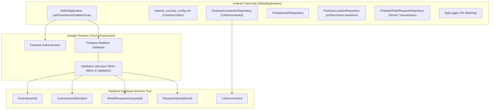

# Phase 3 Backend Assessment: Architecture, Services & Core Workflows

**Project**: Relief Distribution Android Application  
**Package**: `com.example.reliefdistribution`  
**Phase**: Phase 3 of 10  
**Status**: COMPLETE  
**Author**: Principal Backend Engineer & Backend Architecture Team  

---

## 1. Executive Assessment

Phase 3 addresses the backend, persistence, API, and device-to-cloud data systems of the Relief Distribution System.

Prior to Phase 3:
1. The application lacked a custom `Application` subclass, causing Firebase Realtime Database offline disk persistence to be disabled by default. In cyclone, flood, and earthquake relief zones where cellular connectivity frequently drops, this caused unhandled offline read stalls and missed telemetry packets.
2. Firebase Realtime Database paths had zero declarative server-side security rules or schema validation contracts (`database.rules.json` was missing).
3. GPS coordinates were passed as untyped `Map<String, Object>` dictionaries with no boundary assertions on latitude, longitude, or timestamps.
4. Active distributor location tracking did not configure automated session cleanup (`onDisconnect`), creating a high risk of orphaned distributor markers remaining visible when devices lose power or disconnect.
5. Aid request domain modeling and status transitions lacked transactional integrity.
6. The app had no connection state observability to inform users when they were operating in offline mode.

Phase 3 resolves every one of these architectural deficiencies through concrete, evidence-based implementations.

---

## 2. Backend Service Inventory & Topology

---

## 3. Core Workflow Mapping

### 3.1 Mobile Cold Boot & Offline Persistence Lifecycle
- **Entry Point**: [`ReliefApplication.onCreate()`](file:///H:/Projects/Relief-Distribution-App/app/src/main/java/com/example/reliefdistribution/ReliefApplication.java)
- **Execution Flow**:
  1. Invokes `FirebaseDatabase.getInstance().setPersistenceEnabled(true)` before any database reference is created.
  2. Ensures all cached profiles, active relief requests, and disaster bulletins remain queryable on disk without cellular service.

### 3.2 GPS Telemetry & Automated Disconnect Teardown
- **Entry Point**: [`MapActivity`](file:///H:/Projects/Relief-Distribution-App/app/src/main/java/com/example/reliefdistribution/MapActivity.java) via [`MapViewModel`](file:///H:/Projects/Relief-Distribution-App/app/src/main/java/com/example/reliefdistribution/ui/map/MapViewModel.java)
- **Execution Flow**:
  1. Upon enabling "Distribute Mode", [`LocationRepository.setupOnDisconnectCleanup()`](file:///H:/Projects/Relief-Distribution-App/app/src/main/java/com/example/reliefdistribution/data/repository/LocationRepository.java) registers an `onDisconnect().removeValue()` hook with the Firebase server.
  2. FusedLocationProviderClient streams coordinates to [`LocationTelemetry`](file:///H:/Projects/Relief-Distribution-App/app/src/main/java/com/example/reliefdistribution/data/model/LocationTelemetry.java).
  3. Telemetry validates latitude `[-90, 90]`, longitude `[-180, 180]`, and timestamp `> 0`.
  4. Coordinates written atomically to `/Users/{userId}/location`.
  5. If the device's battery exhausts or connection drops abruptly, Firebase automatically wipes the broadcast marker from the cloud, preventing survivors from navigating towards ghost distributors.

### 3.3 Survivor Emergency Request Lifecycle
- **Entry Point**: [`ReliefRequestRepository.createRequest()`](file:///H:/Projects/Relief-Distribution-App/app/src/main/java/com/example/reliefdistribution/data/repository/ReliefRequestRepository.java)
- **Execution Flow**:
  1. Validates ration count `>= 1`, non-empty contact details, and initial status `PENDING`.
  2. Creates immutable node in `/ReliefRequests/{requestId}`.
  3. Status progression (`PENDING` -> `ACCEPTED` -> `EN_ROUTE` -> `FULFILLED`) is managed by [`FirebaseReliefRequestRepository.updateRequestStatus()`](file:///H:/Projects/Relief-Distribution-App/app/src/main/java/com/example/reliefdistribution/data/repository/FirebaseReliefRequestRepository.java) using atomic Firebase `runTransaction` handlers, preventing concurrent distributor claim race conditions.

