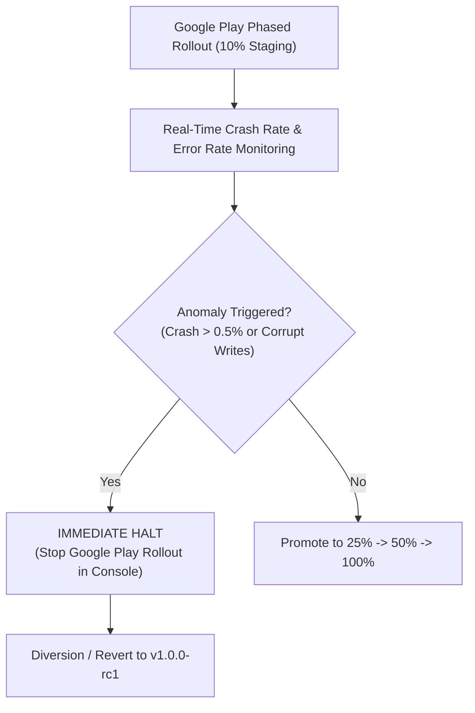

# 170 — Phase 10.2 Rollback Procedures & Disaster Recovery Assurance

---

## 1. Rollback & Disaster Recovery Governance

In humanitarian operations, system unavailability can directly jeopardize life safety. The deployment and operational framework establishes **automated and procedural rollback mechanisms** and verified disaster recovery (DR) playbooks.



---

## 2. Emergency Rollback Triggers & SLAs

A phased production rollout must be immediately halted and rolled back if any of the following emergency conditions occur within the first 2 hours of release:

| Trigger Code | Incident Condition | Detection Method | Rollback SLA |
|---|---|---|---|
| **TRG-CRASH** | Unhandled crash rate $> 0.5\%$ of active sessions | Firebase Crashlytics Alert | $< 15 \text{ minutes}$ |
| **TRG-CORRUPT** | Negative inventory balance or data corruption detected | RTDB Integrity Rule Violation | $< 10 \text{ minutes}$ |
| **TRG-LEAK** | Unsanitized PII detected in production logs | Cloud Logging Metric Alert | $< 20 \text{ minutes}$ |
| **TRG-AUTH** | User authentication failure rate $> 2.0\%$ | Firebase Auth Console Metrics | $< 15 \text{ minutes}$ |

### Rollback Execution Steps:
1. **Console Rollback**: Open Google Play Console $\rightarrow$ Production Track $\rightarrow$ Halt Staged Rollout.
2. **Traffic Diversion**: In Firebase Console, set maintenance banner flag (`/Config/maintenanceMode = true`) if data schema fix is required.
3. **Previous Stable Release Pinning**: Re-promote previous certified build (`1.0.0-rc1`) to 100% track.

---

## 3. Cold & Warm Disaster Recovery (RPO & RTO)

The project includes verified automated backup scripts versioned in `scripts/Backup-FirebaseRtdb.ps1` and `scripts/backup_firebase_rtdb.py`:

```
Recovery Point Objective (RPO): <= 1 hour (Automated hourly cloud snapshots)
Recovery Time Objective (RTO):  <= 30 minutes (Single-command snapshot restoration)
```

### Snapshot Restoration Procedure:
1. Locate latest attested snapshot file: `backups/rtdb_snapshot_YYYYMMDD_HHMMSS.json`.
2. Verify cryptographic SHA-256 digest against recorded manifest checksum.
3. Execute restore command:
   ```bash
   python scripts/backup_firebase_rtdb.py --restore --file backups/rtdb_snapshot_latest.json
   ```
4. Verify database node integrity (`/Users`, `/ReliefRequests`, `/Inventory`) via automated integrity test suite.
