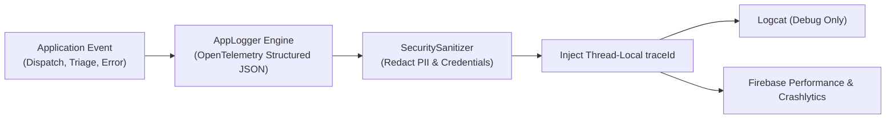

# 171 — Phase 10.2 Observability, Structured Logging & Incident Playbooks

---

## 1. Production Observability Architecture

The application implements enterprise-grade observability via **AppLogger (`AppLogger.java`)**, providing OpenTelemetry-compatible structured JSON logging with distributed request tracing.



---

## 2. Structured JSON Event Format

Every log emission follows a rigid schema to enable automated parsing by Cloud Monitoring and ELK/Datadog collectors:

```json
{
  "timestamp": "2026-11-16T15:20:00.123Z",
  "level": "INFO",
  "traceId": "tr-7f8a9b0c-1234-5678",
  "component": "ReliefWorkflowAutomator",
  "message": "Relief request status updated to Assigned",
  "context": {
    "requestId": "REQ-1700000000000-XYZ",
    "userId": "usr_survivor_01",
    "reliefType": "Food",
    "quantity": 5
  }
}
```

- **Trace Correlation**: Thread-local `traceId` persists across asynchronous operations (`AppExecutors`), enabling distributed transaction tracing from UI click through cloud synchronization.
- **Automated PII Masking**: Email addresses (`j***e@example.com`) and phone numbers (`+88017****000`) are automatically sanitized before string formatting.

---

## 3. Incident Severity Levels & Response Playbooks

| Severity | Definition | Alert Threshold | Target MTTR | Incident Commander |
|---|---|---|---|---|
| **SEV-1 (Critical)** | Core aid distribution down; database write failures; security compromise. | $> 10$ write errors/min or $> 1.0\%$ crash rate | $< 30 \text{ mins}$ | Principal SRE & Security Lead |
| **SEV-2 (High)** | GPS edge tracking degraded; AI triage scoring falling back to defaults. | $> 5\%$ GPS sync errors for $> 15$ mins | $< 2 \text{ hours}$ | Lead Mobile Engineer |
| **SEV-3 (Medium)** | Non-blocking UI glitch; localized notification delivery delays. | $> 2\%$ notification push timeouts | $< 12 \text{ hours}$ | On-call Engineer |
| **SEV-4 (Low)** | Minor cosmetic artifact; documentation update request. | Backlog task | Next sprint | Development Team |

---

## 4. Standard Operating Procedures (SOPs)

- **SOP-01: Firebase RTDB Unavailability**: Activate client offline persistence; notify field dispatchers via SMS/cellular fallback.
- **SOP-02: Rapid Rollback**: Execute console staged rollout halt within 15 minutes of SEV-1 alert trigger.
- **SOP-03: PII Leak Remediation**: Invalidate session tokens, sanitize client logs, and initiate security breach review.
