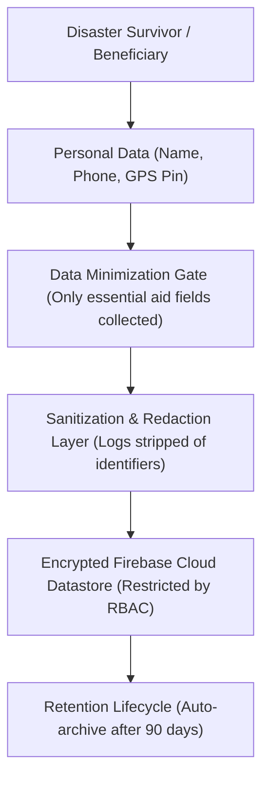

# 172 — Phase 10.2 Data Privacy, PII Protection & Retention Lifecycle

---

## 1. Humanitarian Privacy Framework

In humanitarian crisis relief, beneficiary and distributor data privacy is a fundamental human right. Unprotected location coordinates or identity records can expose vulnerable populations to physical threat. The Relief Distribution System strictly enforces data minimization and privacy-by-design principles.

---

## 2. Personal Identifiable Information (PII) Audit

| Data Field | Purpose | Storage Location | Protection Mechanism |
|---|---|---|---|
| **Survivor Name** | Aid recipient identity | `/Users/$uid/name` | Accessible only to authenticated user and verified distributors. |
| **Survivor Phone** | Contact for aid delivery | `/Users/$uid/phone` | Masked in all diagnostic logs (`+88017****000`). |
| **Survivor Coordinates** | Drop-off point for relief supplies | `/ReliefRequests/$id/` | Scoped to active requests; never exposed to unauthenticated users. |
| **Distributor Real-Time GPS** | Active tracking during transit | `/Locations/$distributorId` | Ephemeral; overwritten on each fix; pruned on logout. |
| **User Password** | Account credentials | **NONE (Firebase Auth)** | Never stored or handled in application database. |

---

## 3. Data Retention & Archival Lifecycle Policy

1. **Active Relief Requests**: Retained in active node until status reaches `Delivered` or `Cancelled`.
2. **Archived Relief Records**: Requests delivered $> 90 \text{ days}$ prior are scheduled for cold export and automated pruning from active Firebase Realtime Database trees.
3. **Distributor Telemetry Cleanup**: Real-time distributor GPS fixes in `/Locations` are strictly ephemeral. Upon completing delivery or logging out, the distributor's location entry is automatically purged.
4. **Beneficiary Right to Erasure**: Survivors can request complete profile deletion via administrative workflow, initiating immediate cascading deletion across `/Users` and active requests.
