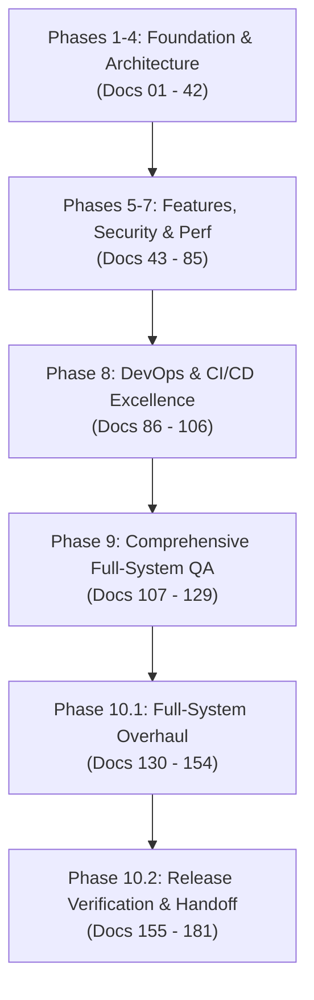

# 173 — Phase 10.2 Technical Documentation Audit & Developer Onboarding

---

## 1. Documentation Ecosystem Audit

The engineering documentation suite in `docs/upgrade/` has been systematically maintained and expanded across all 10 transformation phases, currently comprising 181 comprehensive specifications:



---

## 2. Developer Quick-Start & Onboarding Manual

New software engineers joining the Relief Distribution project can achieve complete local build capability in under 15 minutes by executing the following protocol:

### Prerequisites:
- **Java Development Kit**: Eclipse Temurin or OpenJDK 17 (Zulu 64-Bit).
- **Android SDK**: Android API 34 platform tools and SDK build tools 34.0.0.
- **Git & PowerShell**: Standard Git 2.40+ and Windows PowerShell.

### Step-by-Step Setup:
```bash
# 1. Clone repository
git clone https://github.com/organization/Relief-Distribution.git
cd Relief-Distribution

# 2. Configure local secrets (Google Maps API Key)
echo "MAPS_API_KEY=AIzaSyFakeKeyForLocalDevelopmentOnly" > local.properties

# 3. Execute hermetic unit test verification
./gradlew.bat testDebugUnitTest

# 4. Assemble debug candidate APK
./gradlew.bat assembleDebug

# 5. Launch application on connected emulator / device
./gradlew.bat installDebug
```

---

## 3. Architecture Decision Records (ADR) Index

The project maintains 37 formal Architecture Decision Records versioned in [08-architecture-decisions.md](file:///h:/Projects/Relief-Distribution/docs/upgrade/08-architecture-decisions.md):
- **ADR-001 through ADR-010**: Foundations, plain-text password removal, security rules, MVVM patterns.
- **ADR-011 through ADR-020**: Jetpack ViewBinding, Material Design 3 tokens, zero-trust RBAC, and ProGuard hardening.
- **ADR-021 through ADR-030**: OpenTelemetry logging, automated DR snapshots, AI triage bounds, edge GPS compaction.
- **ADR-031 through ADR-037**: Defect remediation, interactive map picker, and final production certification.
