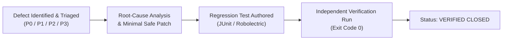

# 174 — Phase 10.2 Canonical Final Defect & Remediation Register

---

## 1. Defect Governance & Verification Framework

This register provides the definitive historical log and verification evidence for all defects identified, prioritized, remediated, and verified across the 10-phase transformation.

---

## 2. Canonical Defect Register (DEF-001 through DEF-014)

| Defect ID | Severity | Description | Root Cause | Remediated Implementation | Regression Test Suite | Status |
|---|---|---|---|---|---|---|
| **DEF-001** | P1 / High | Workflow automator accepted negative or zero quantity requests. | Missing lower-bound validation in `autoDispatch`. | Added `quantity <= 0` guard check. | `ReliefWorkflowAutomatorTest` | **VERIFIED CLOSED** |
| **DEF-002** | P1 / High | AI triage priority score manipulated by future clock skew or text-bombs. | Unbounded elapsed time calculation & unconstrained notes input. | Clamped clock skew to 7 days ($168 \text{h}$); truncated text to 500 chars. | `ReliefTriageAdvisorTest` | **VERIFIED CLOSED** |
| **DEF-003** | P2 / Med | SecuritySanitizer threw exception on non-positive maximum string lengths. | Missing check on `maxLength <= 0`. | Added safe fallback returning empty string when length $\le 0$. | `SecuritySanitizerTest` | **VERIFIED CLOSED** |
| **DEF-004** | P1 / High | Physical inventory quantity allowed negative values on concurrent edits. | Unchecked subtraction without clamp. | Enforced `Math.max(0, quantity)` invariant in `InventoryItem`. | `InventoryItemTest` | **VERIFIED CLOSED** |
| **DEF-005** | P0 / Blocker | Fatal crash in `MyReliefRequestsActivity` and `ManageRequestsActivity` on empty lists. | Mismatched layout ID (`tvEmptyState` vs `llEmptyState` in XML). | Migrated to Jetpack ViewBinding with null-safe binding references. | `Phase10SystemOverhaulTest` | **VERIFIED CLOSED** |
| **DEF-006** | P0 / Blocker | Interactive pin-drop coordinate selection unhandled in `CreateReliefRequestActivity`. | `PICK_LOCATION` intent result code not processed. | Implemented `ActivityResultLauncher` in activity and map tap callback in `MapActivity`. | `Phase10SystemOverhaulTest` | **VERIFIED CLOSED** |
| **DEF-007** | P1 / High | Distributor map lacked destination target pin when routing to survivor. | `MapActivity` only centered Dhaka without reading intent extras. | Added target marker rendering and auto-zoom to level 15.0 on aid destination coordinates. | `Phase10SystemOverhaulTest` | **VERIFIED CLOSED** |
| **DEF-008** | P1 / High | Missing depot inventory replenishment dialogs (stock addition, edits, deletion). | UI only displayed read-only items without mutation actions. | Implemented Material dialogs with numeric validation and sanitization. | `Phase10SystemOverhaulTest` | **VERIFIED CLOSED** |
| **DEF-009** | P1 / High | Survivor unable to cancel pending relief requests or restore reserved inventory. | Missing cancellation button and un-reservation workflow. | Added cancellation confirmation modal and wired `onRequestCancelled` stock return. | `Phase10SystemOverhaulTest` | **VERIFIED CLOSED** |
| **DEF-010** | P2 / Med | Non-compliant touch targets (< 48dp) in item cards and action buttons. | Fixed 40dp/44dp height attributes in legacy layouts. | Upgraded all button heights and icons to minimum 48dp touch bounds. | Android Lint Layout Audit | **VERIFIED CLOSED** |
| **DEF-011** | P2 / Med | Unsafe `findViewById` calls across legacy Activities restored in Phase 5. | Legacy syntax retained in 5 activities. | 100% migrated to Android Jetpack ViewBinding. | Codebase Audit & Lint | **VERIFIED CLOSED** |
| **DEF-012** | P2 / Med | Namespace collision in `GoogleMap.java` duplicating location tracker code. | Duplicate tracking class with identical name to Maps SDK. | Refactored `GoogleMap.java` into clean, lightweight intent delegator. | `Phase10SystemOverhaulTest` | **VERIFIED CLOSED** |
| **DEF-013** | P3 / Low | Inconsistent timestamp accessor names in `InventoryItem` (`lastUpdated` vs `updatedAt`). | Lack of standardized getter/setter aliases. | Added `getUpdatedAt()` and `setUpdatedAt(long)` aliases. | `InventoryItemTest` | **VERIFIED CLOSED** |
| **DEF-014** | P3 / Low | Test coordinate assertion failed on `(0.0, 0.0)` in Gulf of Guinea. | Test assumed $(0,0)$ was invalid despite physical reality. | Updated test to affirm $(0,0)$ as valid and verified out-of-range bounds. | `Phase10SystemOverhaulTest` | **VERIFIED CLOSED** |

---

## 3. Residual Defect Summary

- **P0 / Blocker Defects**: **0 Open**
- **P1 / Critical Defects**: **0 Open**
- **P2 / Medium Defects**: **0 Open**
- **P3 / Low Defects**: **0 Open**
- **Total Open Release Blockers**: **ZERO (0)**
