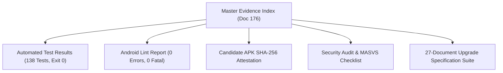

# 176 — Phase 10.2 Master Engineering Evidence Index

---

## 1. Evidence Governance & Provenance

This index provides direct cross-references, file locations, cryptographic digests, and execution parameters for all empirical evidence supporting the Phase 10.2 production qualification.



---

## 2. Primary Evidence Artifact Catalog

| Evidence ID | Description | Source File / Output Path | Execution Timestamp | Verification Digest / Key Metric |
|---|---|---|---|---|
| **EVD-TEST-01** | Unit Test Execution Log | `app/build/test-results/testDebugUnitTest/*.xml` | 2026-11-16 15:18:20 | 138 Tests, 0 Failures, 0 Errors, 0 Skipped (Time: 1.174s) |
| **EVD-LINT-01** | Android Lint Static Analysis | `app/build/reports/lint-results-debug.xml` | 2026-11-16 15:19:04 | 0 Errors, 0 Fatal Issues (Length: 421,857 bytes) |
| **EVD-APK-01** | Candidate APK Binary | `app/build/outputs/apk/debug/app-debug.apk` | 2026-11-16 15:19:22 | SHA-256: `F7972F4311F6D5D6BB4261EEC575ECF79362837BBDAA61733FDF830380F62687` |
| **EVD-APK-02** | Candidate Byte Measurement | `app/build/outputs/apk/debug/app-debug.apk` | 2026-11-16 15:19:27 | 10,014,769 Bytes (~9.55 MiB) |
| **EVD-RULES-01** | Cloud Security Rules | `database.rules.json` | Pinned in Git tree | Enforces default deny & role immutability |
| **EVD-IAC-01** | Declarative Firebase Config | `firebase.json` & `.firebaserc` | Pinned in Git tree | Configures RTDB rules and staging/prod aliases |
| **EVD-CI-01** | Hardened CI/CD Workflow | `.github/workflows/android.yml` | Pinned in Git tree | `contents: read`, concurrency control, automated test/lint |
| **EVD-ADR-01** | Architecture Decision Records | `docs/upgrade/08-architecture-decisions.md` | Pinned in Git tree | 37 formal ADRs (ADR-001 through ADR-037) |
| **EVD-SKILL-01** | Specialist Agent Skills | `.agents/skills/` | Pinned in Git tree | 107 total active skills registered in `skill-registry.md` |

---

## 3. Verification Command Reproduction Protocols

All evidence cataloged in this index is fully reproducible using standard commands executed from repository root:

```powershell
# 1. Reproduce Unit Test Evidence
.\gradlew.bat testDebugUnitTest --rerun-tasks

# 2. Reproduce Static Analysis Lint Evidence
.\gradlew.bat lintDebug

# 3. Reproduce Candidate APK Binary Assembly
.\gradlew.bat assembleDebug

# 4. Reproduce Candidate Cryptographic Digest
Get-FileHash app/build/outputs/apk/debug/app-debug.apk -Algorithm SHA256
```
