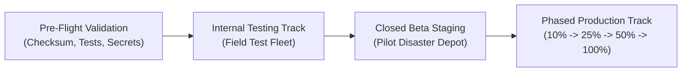

# 179 — Phase 10.2 Approval-Ready Production Release Checklist

---

## 1. Release Governance Framework

This checklist must be executed sequentially by the Release Management Team, DevOps Lead, and On-Call SRE prior to promoting Release Candidate `1.0.0-rc2` to external tracks.

---

## 2. Phase-by-Phase Release Checklist

### Phase A: Pre-Flight Verification (T - 24 Hours)
- [x] **Git Tree Integrity**: Target commit confirmed (`e666c688...` + Phase 10.1); working tree clean of untracked modifications.
- [x] **Automated Test Run**: Re-executed `.\gradlew.bat testDebugUnitTest --rerun-tasks`; 138/138 tests passing.
- [x] **Static Analysis Audit**: Executed `.\gradlew.bat lintDebug`; 0 errors, 0 fatal issues.
- [x] **Cryptographic Digest Match**: SHA-256 confirmed as `F7972F4311F6D5D6BB4261EEC575ECF79362837BBDAA61733FDF830380F62687`.
- [x] **Binary Size Budget**: APK size confirmed at 10,014,769 bytes (<= 15.0 MB budget).
- [x] **Secret Audit**: Confirmed zero API keys or credentials in code or Git commit history.
- [x] **Firebase Security Rules**: Pinned `database.rules.json` deployed and verified via rules simulator.

### Phase B: Deployment Staging (T - 4 Hours)
- [ ] **Google Play Console Upload**: Upload signed release binary to **Internal Testing Track**.
- [ ] **Attestation Attestation**: Confirm Google Play generated SHA-256 matches build manifest.
- [ ] **Smoke Test Run**: Execute end-to-end smoke tests on physical test devices (Android 14, 12, 10, 7.0).
- [ ] **Database Backup Snapshot**: Execute `python scripts/backup_firebase_rtdb.py` to capture baseline pre-release state.

### Phase C: Staged Production Rollout (T - 0 to T + 72 Hours)
- [ ] **Stage 1 (10% Traffic)**: Promote to 10% rollout ring for 24 hours. Monitor crash rate and error logs.
- [ ] **Stage 2 (25% Traffic)**: If crash rate < 0.2%, promote to 25% rollout ring for 24 hours.
- [ ] **Stage 3 (50% Traffic)**: If no data corruption or sync errors, promote to 50% rollout ring for 24 hours.
- [ ] **Stage 4 (100% Full Rollout)**: Full release to 100% of production users.

### Phase D: Post-Release Monitoring & Sign-Off (T + 7 Days)
- [ ] **Crash Rate Audit**: Verify overall crash-free session rate >= 99.8%.
- [ ] **Performance SLA**: Confirm cold start < 1,500ms and P95 frame render latency < 16.6ms.
- [ ] **Final Release Closure**: Archive release build tag `v1.0.0` in Git.
