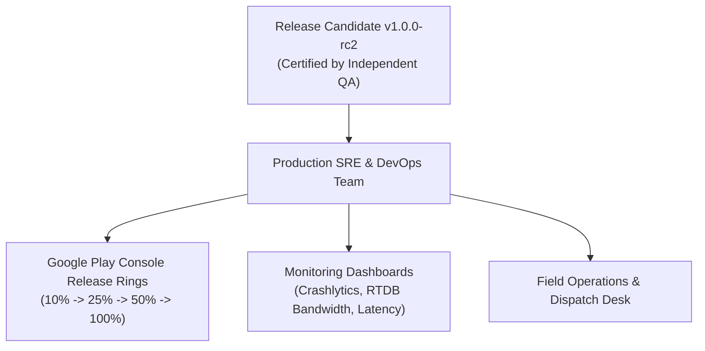

# 180 — Phase 10.2 Operations Handoff & Staged Rollout Playbook

---

## 1. Operational Transition & Handoff Charter

With the completion of Phase 10.2, software engineering authority is officially transferred to the **Production Operations, Site Reliability Engineering (SRE), and Field Support Teams**.



---

## 2. Staged Rollout Ring Schedule

To protect disaster relief coordination from unexpected widespread failures, deployment follows a 4-tier phased rollout:

| Rollout Stage | Target Audience | Duration | Gate Criteria for Advancement |
|---|---|---|---|
| **Stage 1 (10%)** | 10% Random Production Cohort | 24 Hours | Crash-free sessions $\ge 99.8\%$; 0 fatal NPEs; error rate $< 0.1\%$. |
| **Stage 2 (25%)** | 25% Production Cohort | 24 Hours | RTDB write latency P95 $< 250\text{ms}$; 0 inventory discrepancies. |
| **Stage 3 (50%)** | 50% Production Cohort | 24 Hours | Telemetry sync success $\ge 99.5\%$; 0 PII leak alerts. |
| **Stage 4 (100%)** | 100% General Availability | Continuous | Sustained operational stability; normal support handoff. |

---

## 3. Operational Monitoring Dashboards & Thresholds

The SRE team must monitor the following key metrics in real time during each rollout window:

1. **Firebase Crashlytics Dashboard**:
   - Alert Threshold: Unhandled crash rate $> 0.2\%$.
   - Urgent Threshold: Unhandled crash rate $> 0.5\%$ (Triggers automatic rollout halt).
2. **Firebase Realtime Database Metrics**:
   - Bandwidth consumption rate.
   - Concurrent WebSocket connection count.
   - Storage write rate and rejected security rules operations.
3. **OpenTelemetry Log Aggregation**:
   - Filter query: `level: "ERROR" OR level: "WARN"`.
   - Alert on unexpected spike in `ReliefWorkflowAutomator` or `OfflineTelemetryBuffer` failure logs.

---

## 4. Incident Escalation Path & Roster

In the event of an operational anomaly:

```
Level 1: Field Support Desk (Receives distributor & survivor feedback)
   | (Unresolved in 15 mins or Systemic Defect)
   v
Level 2: On-Call SRE Engineer (Evaluates metrics, halts staged rollout if needed)
   | (SEV-1 Critical or Security Incident)
   v
Level 3: Principal Android Architect & Security Lead (Deploys hotfix patch)
```
