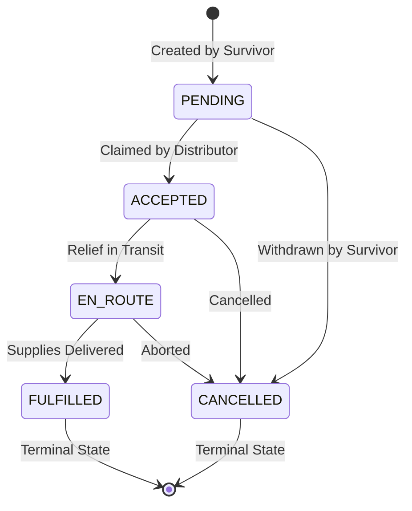

# Phase 3 Domain Invariants & Logic Verification

**Project**: Relief Distribution Android Application  
**Package**: `com.example.reliefdistribution`  
**Phase**: Phase 3 of 10  
**Status**: ACTIVE  
**Author**: Domain Engineering Specialist  

---

## 1. Domain Invariant Registry

| Domain Entity | Invariant Rule | Boundary / Condition | Enforcement Mechanism |
|---|---|---|---|
| [`LocationTelemetry`](file:///H:/Projects/Relief-Distribution-App/app/src/main/java/com/example/reliefdistribution/data/model/LocationTelemetry.java) | Latitude Bounds | Must be a valid number in `[-90.0, 90.0]`. | `IllegalArgumentException` thrown on invalid input; `database.rules.json` validation. |
| [`LocationTelemetry`](file:///H:/Projects/Relief-Distribution-App/app/src/main/java/com/example/reliefdistribution/data/model/LocationTelemetry.java) | Longitude Bounds | Must be a valid number in `[-180.0, 180.0]`. | `IllegalArgumentException` thrown on invalid input; `database.rules.json` validation. |
| [`LocationTelemetry`](file:///H:/Projects/Relief-Distribution-App/app/src/main/java/com/example/reliefdistribution/data/model/LocationTelemetry.java) | Timestamp Integrity | Must be strictly positive (`> 0`). | Throws on negative/zero timestamp. |
| [`ReliefRequest`](file:///H:/Projects/Relief-Distribution-App/app/src/main/java/com/example/reliefdistribution/data/model/ReliefRequest.java) | Ration Count | Must be `>= 1`. | Throws on zero/negative ration count. |
| [`ReliefRequest`](file:///H:/Projects/Relief-Distribution-App/app/src/main/java/com/example/reliefdistribution/data/model/ReliefRequest.java) | Mandatory Identifiers | `requestId`, `userId`, `survivorName`, `phone` cannot be blank. | Throws on null/empty strings. |
| [`ReliefRequest`](file:///H:/Projects/Relief-Distribution-App/app/src/main/java/com/example/reliefdistribution/data/model/ReliefRequest.java) | State Machine Progression | Only valid forward lifecycle transitions permitted. | `isValidTransition()` validation; transaction abort on illegal jumps. |
| [`User`](file:///H:/Projects/Relief-Distribution-App/app/src/main/java/com/example/reliefdistribution/User.java) | Role Integrity | Must be either `"Distributor"` or `"Survivor"`. | `User.isValidRole()` check; ViewModel validation; database rule regex. |
| [`User`](file:///H:/Projects/Relief-Distribution-App/app/src/main/java/com/example/reliefdistribution/User.java) | Email Format | Standard RFC regex validation. | `User.isValidEmail()` check. |
| [`User`](file:///H:/Projects/Relief-Distribution-App/app/src/main/java/com/example/reliefdistribution/User.java) | No Plaintext Password | Model must **never** store passwords. | Zero password fields in `User.java` (verified by reflection unit test). |

---

## 2. Relief Request State Machine

### Transition Matrix

| Current State | Target State | Permitted? | Reason |
|---|---|---|---|
| `PENDING` | `ACCEPTED` | **Yes** | Distributor claims the task. |
| `PENDING` | `CANCELLED` | **Yes** | Survivor cancels duplicate request. |
| `PENDING` | `FULFILLED` | **No** | Cannot fulfill an unaccepted request (skips triage). |
| `ACCEPTED` | `EN_ROUTE` | **Yes** | Distributor begins journey. |
| `ACCEPTED` | `CANCELLED` | **Yes** | Emergency diverted. |
| `EN_ROUTE` | `FULFILLED` | **Yes** | Aid delivered to survivor. |
| `FULFILLED` | `PENDING` | **No** | Terminal states cannot be reverted. |
| `CANCELLED` | `ACCEPTED` | **No** | Terminal states cannot be revived. |

