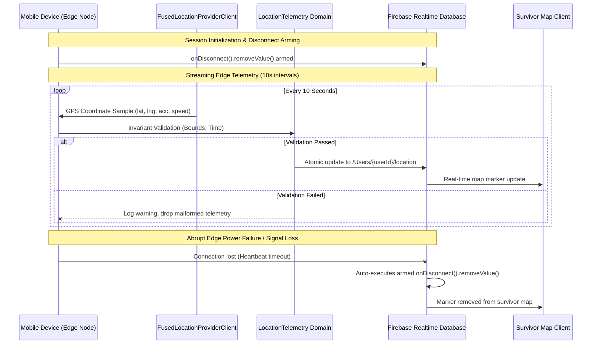

# Phase 3 IoT Services & Mobile Edge Telemetry

**Project**: Relief Distribution Android Application  
**Package**: `com.example.reliefdistribution`  
**Phase**: Phase 3 of 10  
**Status**: ACTIVE  
**Author**: Principal IoT Backend Architect  

---

## 1. Edge-to-Cloud Telemetry Pipeline

In disaster field operations, mobile devices carried by relief distributors and stranded survivors function as distributed edge IoT tracking nodes.

---

## 2. Telemetry Invariant Verification

Edge telemetry streams are governed by [`LocationTelemetry.java`](file:///H:/Projects/Relief-Distribution-App/app/src/main/java/com/example/reliefdistribution/data/model/LocationTelemetry.java):
1. **Latitude Validation**: $-90.0 \le \text{latitude} \le 90.0$.
2. **Longitude Validation**: $-180.0 \le \text{longitude} \le 180.0$.
3. **Timestamp Integrity**: $\text{timestamp} > 0$.
4. **Edge Battery Throttling**: GPS intervals are set to 10-second updates (`setInterval(10000)`) with 5-second minimum thresholds (`setMinUpdateIntervalMillis(5000)`) using `Priority.PRIORITY_HIGH_ACCURACY`. This balances real-time accuracy with battery preservation in disaster areas where charging points are unavailable.

