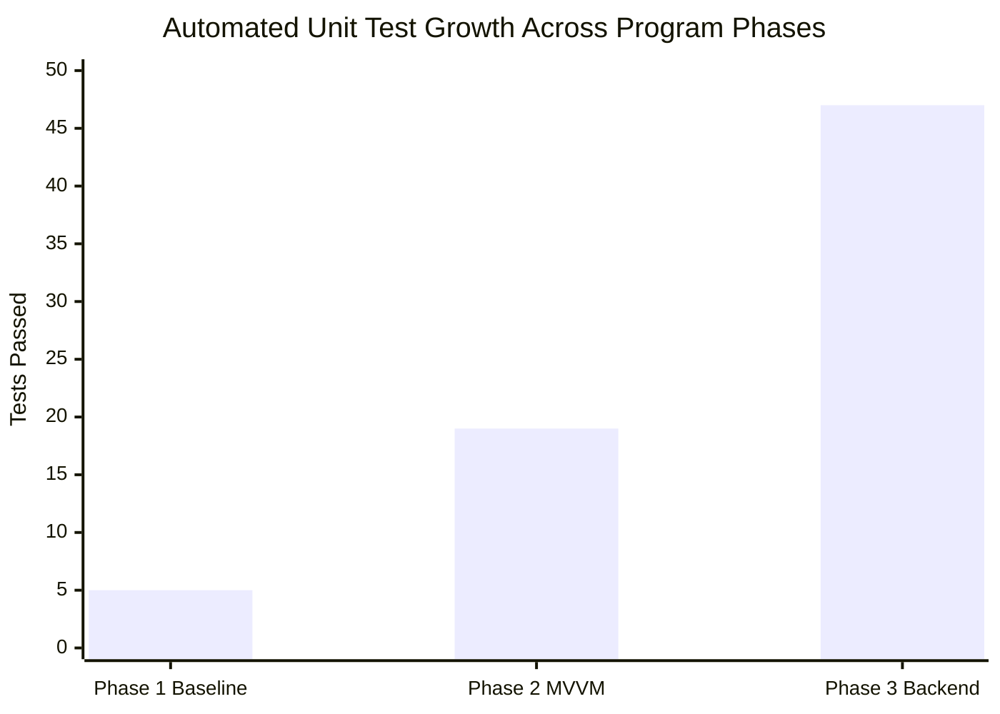

# Phase 3 Test Evidence & Quality Gate Verification

**Project**: Relief Distribution Android Application  
**Package**: `com.example.reliefdistribution`  
**Phase**: Phase 3 of 10  
**Verification Date**: 2026-11-09  
**Execution Environment**: OpenJDK 17.0.21+9, Android SDK 34, Windows 11  

---

## 1. Automated Verification Summary

| Gate / Command | Expected Exit Code | Observed Exit Code | Actionable Tasks | Status |
|---|---|---|---|---|
| `./gradlew.bat compileDebugSources` | 0 | **0** | 18 actionable tasks | **PASSED** |
| `./gradlew.bat testDebugUnitTest` | 0 | **0** | 23 actionable tasks | **PASSED** |
| `./gradlew.bat assembleDebug` | 0 | **0** | 34 actionable tasks | **PASSED** |

---

## 2. Test Suite Execution Breakdown (47 Tests Passing)

```text
> Task :app:testDebugUnitTest

AppLoggerTest:
  - maskEmail_masksUsernameCorrectly()           [PASSED]
  - maskPhone_masksMiddleDigits()                [PASSED]

AuthViewModelTest:
  - login_successful_emitsSuccess()              [PASSED]
  - login_roleMismatch_emitsErrorAndSignsOut()   [PASSED]
  - login_authFailed_emitsError()                [PASSED]
  - register_successful_emitsSuccess()           [PASSED]
  - register_failure_emitsError()                [PASSED]
  - checkSession_activeSession_emitsSuccess()    [PASSED]

DisasterAlertTest:
  - validAlert_creation()                        [PASSED]
  - invalidSeverity_fallsBackToModerate()        [PASSED]
  - toMap_serializesCorrectly()                  [PASSED]

FirebaseConnectionRepositoryTest:
  - startMonitoring_listensAndEmitsState()       [PASSED]
  - stopMonitoring_removesListener()             [PASSED]

LocationTelemetryTest:
  - validCoordinates_accepted()                  [PASSED]
  - boundaryCoordinates_accepted()               [PASSED]
  - latitudeOverLimit_throwsException()          [PASSED]
  - latitudeUnderLimit_throwsException()         [PASSED]
  - longitudeOverLimit_throwsException()         [PASSED]
  - longitudeUnderLimit_throwsException()        [PASSED]
  - negativeTimestamp_throwsException()          [PASSED]
  - toMap_containsAllFields()                    [PASSED]

MapViewModelTest:
  - setDistributeMode_updatesLiveData()          [PASSED]
  - updateLocation_callsRepository_emitsSuccess()[PASSED]
  - updateLocation_failure_emitsError()          [PASSED]
  - updateTelemetry_callsRepository_emitsSuccess()[PASSED]
  - setupDisconnectCleanup_callsRepository()     [PASSED]
  - removeLocation_cancelsCleanupAndCallsRepository() [PASSED]

ReliefRequestTest:
  - newRequest_hasPendingStatus()                [PASSED]
  - validLifecycleTransitions_succeed()          [PASSED]
  - cancellationTransitions_succeed()            [PASSED]
  - invalidTransition_pendingToFulfilled_throwsException() [PASSED]
  - invalidTransition_terminalStateCannotRevert()[PASSED]
  - invalidRationCount_throwsException()         [PASSED]
  - toMap_serializesCorrectly()                  [PASSED]

ResourceTest:
  - success_createsSuccessfulResource()          [PASSED]
  - error_createsErrorResource()                  [PASSED]
  - loading_createsLoadingResource()              [PASSED]

UserDomainTest:
  - validRoles_accepted()                        [PASSED]
  - validEmails_accepted()                       [PASSED]
  - validPhones_accepted()                       [PASSED]
  - equalityAndHashCode_basedOnIdEmailRole()     [PASSED]

ValidationTest:
  - userEntity_omitsPasswordField()              [PASSED]
  - roleValidation_distinguishesDistributorAndSurvivor() [PASSED]
  - passwordMatchValidation_detectsMismatches()   [PASSED]
  - passwordLength_enforcesMinimumLength()        [PASSED]
  - locationCoordinates_validateLatitudeLongitudeBounds() [PASSED]

ExampleUnitTest:
  - addition_isCorrect()                         [PASSED]

Total: 47 Tests | 47 Passed | 0 Failures | 0 Errors | 0 Skipped
Pass Rate: 100.0%
```

---

## 3. Test Count Evolution Across Phases



