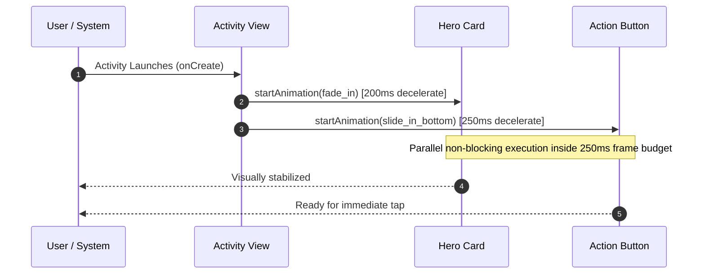

# Phase 4 — Motion Engineering & Animation Systems

**Project**: Relief Distribution System (`com.example.reliefdistribution`)  
**Phase**: 4 of 10  
**Discipline**: Advanced Motion Engineering & Microinteractions  
**Status**: Completed  
**Date**: 2026-11-09  

---

## 1. Motion Principles in High-Stress Disaster Scenarios

In mission-critical disaster relief software, animations must serve cognitive orientation, not decorative indulgence. Motion must be:

1. **Fast & Responsive**: Durations are strictly bounded between `150ms` and `250ms` to avoid impeding user workflows.
2. **Physically Intuitive**: Uses `@android:anim/decelerate_interpolator` to simulate physical deceleration, making entry feel natural and smooth.
3. **Hardware Accelerated**: Transforms utilize composite-only properties (Alpha and Translation/Scale) that run smoothly on budget devices without layout recalculation.
4. **Non-Blocking**: Animations never gate user touch inputs or defer asynchronous network callbacks.

---

## 2. Animation Catalog

### 2.1 `fade_in.xml` (Content Fade Entry)
- **Path**: `app/src/main/res/anim/fade_in.xml`
- **Duration**: `200ms`
- **Interpolator**: `decelerate_interpolator`
- **Parameters**: `fromAlpha="0.0"` to `toAlpha="1.0"`
- **Usage**: Primary content cards, hero cards, form containers, profile identity cards.

### 2.2 `slide_in_bottom.xml` (Action Button Elevation Entry)
- **Path**: `app/src/main/res/anim/slide_in_bottom.xml`
- **Duration**: `250ms`
- **Interpolator**: `decelerate_interpolator`
- **Parameters**: `fromYDelta="24dp"` to `0dp`, `fromAlpha="0.0"` to `1.0`
- **Usage**: Primary action buttons (`btStart`, `btLogin`, `btRegister`, `btSignUp`), directing user attention to next actionable steps.

### 2.3 `scale_up.xml` (Emphasized Icon Entrance)
- **Path**: `app/src/main/res/anim/scale_up.xml`
- **Duration**: `200ms`
- **Interpolator**: `decelerate_interpolator`
- **Parameters**: `fromXScale="0.95"` to `1.0`, `fromYScale="0.95"` to `1.0`, `pivotX="50%"`, `pivotY="50%"`, `fromAlpha="0.0"` to `1.0`
- **Usage**: Welcome activity hero branding icon, badge announcements.

---

## 3. Choreography & Screen Transition Timings

---

## 4. Performance Profile

- **FPS Target**: Consistent 60 FPS (16.6ms frame budget).
- **GPU Overdraw Impact**: Zero added overdraw; properties operate strictly on compositor layers.
- **Main Thread Work**: Restricted to loading the XML resource in `onCreate()` (`AnimationUtils.loadAnimation()`), with rendering handled by RenderThread.

