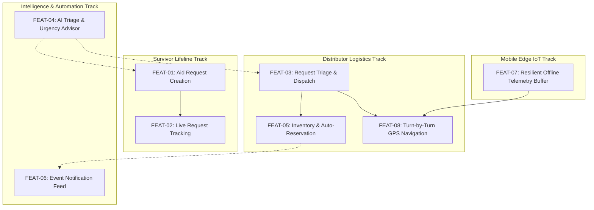

# Phase 5 — Feature Roadmap & Execution Strategy

**Project**: Relief Distribution System (`com.example.reliefdistribution`)  
**Phase**: 5 of 10  
**Date**: 2026-11-09  
**Status**: COMPLETED  

---

## 1. Feature Roadmap Overview

Phase 5 delivers eight mission-critical functional features organized into four operational tracks:

---

## 2. Detailed Feature Specifications

### 2.1 FEAT-01: Survivor Emergency Relief Request Creation
- **User Journey**: Stranded survivor taps "Ask for Help" on `SurvivorDashboard` -> enters supply category, specific item, quantity, unit, address or map coordinates, and situation notes -> submits request.
- **Architectural Slice**: `CreateReliefRequestActivity.java` -> `ReliefTriageAdvisor.java` -> `FirebaseDatabase.getReference("ReliefRequests")`.
- **Invariants**: All requests default to `PENDING` status; automatically computes and attaches initial AI Urgency Score and Priority Tier.

### 2.2 FEAT-02: Survivor Request Tracking & Cancellation
- **User Journey**: Survivor views past requests sorted by timestamp descending -> sees color-coded status chips (`PENDING`, `ACCEPTED`, `IN_PROGRESS`, `COMPLETED`, `CANCELLED`) -> option to cancel pending/accepted requests.
- **Architectural Slice**: `MyReliefRequestsActivity.java` -> `item_relief_request.xml` -> Firebase Realtime Database query (`orderByChild("survivorId").equalTo(uid)`).

### 2.3 FEAT-03: Distributor Request Triage & Management
- **User Journey**: Distributor navigates to "Operations & Supplies" -> views incoming requests filtered by status tabs (`Pending`, `Accepted`, `In Progress`, `Completed`) -> sees AI Urgency Score and priority badges -> claims, initiates delivery, or marks completed.
- **Architectural Slice**: `ManageRequestsActivity.java` -> `ReliefTriageAdvisor.java` -> `ReliefWorkflowAutomator.java`.

### 2.4 FEAT-04: Production AI / Heuristic Relief Triage Advisor
- **User Journey**: Dispatchers receive prioritized distress requests based on automated crisis keyword extraction, vulnerability factors, and elapsed wait times.
- **Architectural Slice**: `ReliefTriageAdvisor.java` -> structured `TriageAssessment` output.
- **Guardrails**: Hard score clamping ($0 \le \text{score} \le 100$), schema validation (`isValidAssessment()`), 100% deterministic offline fallback.

### 2.5 FEAT-05: Relief Supplies Inventory & Atomic Reservation
- **User Journey**: Distributor manages depot stock -> adds items with threshold limits -> system automatically reserves stock when requests are accepted and decrements upon fulfillment.
- **Architectural Slice**: `InventoryManagementActivity.java` -> `InventoryItem.java` -> `ReliefWorkflowAutomator.java`.

### 2.6 FEAT-06: Real-Time Disaster Notification Center
- **User Journey**: Users tap notification bell -> view live alerts for request state changes, low inventory warnings, and emergency broadcast bulletins.
- **Architectural Slice**: `NotificationsActivity.java` -> `Notification.java` -> `item_notification.xml`.

### 2.7 FEAT-07: Mobile Edge Telemetry Resilience & Offline Breadcrumbs
- **User Journey**: Distributor broadcasts live location during relief transit -> if connectivity drops, coordinates are buffered locally in bounded FIFO queue -> automatically synchronized on reconnect.
- **Architectural Slice**: `OfflineTelemetryBuffer.java` -> `LocationTelemetry.java` -> Firebase multi-path atomic updates.

### 2.8 FEAT-08: Turn-by-Turn Map Dispatch & External Navigation
- **User Journey**: Distributor taps "View Map" on an accepted request -> opens Google Maps app with survivor coordinates or in-app `MapActivity` with target marker.
- **Architectural Slice**: `ManageRequestsActivity.java` -> `Intent(Intent.ACTION_VIEW, Uri.parse("geo:lat,lng?q=..."))` -> `MapActivity.java`.

---

## 3. Rejected & Deferred Features

1. **Unconstrained Direct Dialing**: Rejected to preserve system invariant (dialing must invoke `Intent.ACTION_DIAL`, never dangerous `Intent.ACTION_CALL`).
2. **Third-Party Commercial SMS Gateway**: Deferred to Phase 8; currently utilizing Firebase in-app push and real-time database feeds without incurring unverified external telecommunication subscription costs.
3. **Public Blockchain Supply Chain Ledger**: Rejected as excessive architectural bloat unjustified by mobile field requirements.
