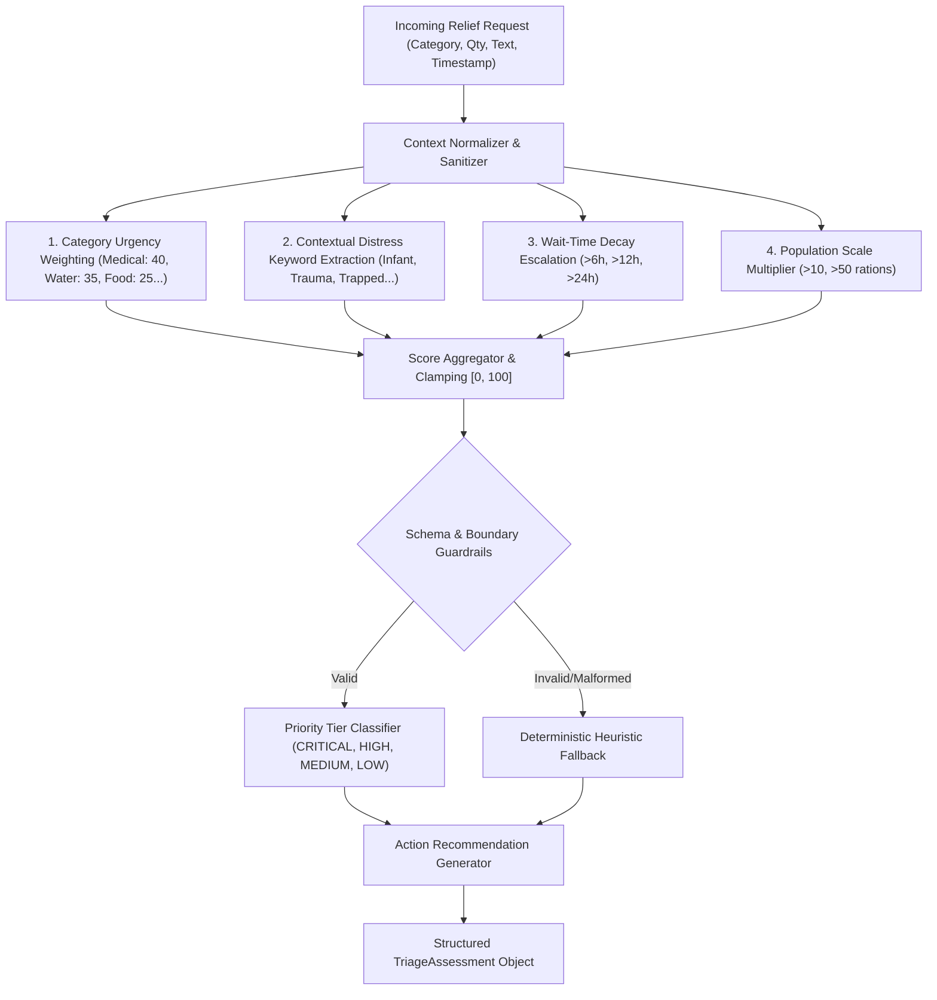

# Phase 5 — Production AI Architecture & Triage Intelligence

**Project**: Relief Distribution System (`com.example.reliefdistribution`)  
**Package**: `com.example.reliefdistribution.data.ai`  
**Phase**: 5 of 10  
**Date**: 2026-11-09  
**Status**: ACTIVE  

---

## 1. Architectural Problem Statement

In the aftermath of major natural disasters (cyclones, monsoons, river erosion, flash floods in Bangladesh), emergency coordination centers are flooded with unstructured, ambiguous distress messages. Stranded citizens submit varying requests ranging from non-urgent supply replenishments to imminent life-or-death entrapment with infants and wounded victims.

Manual triage introduces severe latency and cognitive fatigue, risking delays for trapped survivors. Conversely, naive cloud LLM integration introduces latency spikes, network dependency during cell-tower outages, and risk of hallucinations.

---

## 2. Hybrid AI Architecture & Processing Pipeline

The system employs a **Hybrid Edge-Resilient Triage Architecture** governed by [`ReliefTriageAdvisor.java`](file:///H:/Projects/Relief-Distribution/app/src/main/java/com/example/reliefdistribution/data/ai/ReliefTriageAdvisor.java):

---

## 3. Mathematical Scoring Model

The urgency score $S \in [0, 100]$ is computed deterministically via the following formulation:

$$S = \min\left(100, \max\left(0, W_{\text{cat}} + W_{\text{scale}} + \sum_{k \in K} W_k + W_{\text{wait}}\right)\right)$$

Where:
- **$W_{\text{cat}}$ (Category Base Urgency)**:
  $$\begin{cases}
  40 & \text{if Medicine/Medical Aid} \\
  35 & \text{if Drinking Water} \\
  25 & \text{if Food/Rations} \\
  20 & \text{if Shelter/Tarpaulins} \\
  15 & \text{if Clothing/Hygiene} \\
  10 & \text{General/Other}
  \end{cases}$$
- **$W_{\text{scale}}$ (Population Scale)**:
  $$\begin{cases}
  10 & \text{if Quantity} > 50 \\
  5 & \text{if Quantity} > 10 \\
  0 & \text{otherwise}
  \end{cases}$$
- **$W_k$ (Contextual Distress Extraction)**:
  - Trapped / Flood Water / Submerged: $+35$ (`TRAPPED_IMMINENT_DANGER`)
  - Active Trauma / Injury / Bleeding / Hospital: $+25$ (`ACTIVE_TRAUMA_OR_INJURY`)
  - Infant / Baby / Formula / Pregnant: $+20$ (`VULNERABLE_INFANT_OR_CHILD`)
  - Elderly / Disabled / Wheelchair: $+15$ (`VULNERABLE_ELDERLY_OR_DISABLED`)
  - Malnutrition / Starvation: $+15$ (`SEVERE_MALNUTRITION_RISK`)
  - Waterborne Disease / Cholera: $+15$ (`MEDICAL_COMPLICATION`)
- **$W_{\text{wait}}$ (Elapsed Wait Time Escalation)**:
  $$\begin{cases}
  15 & \text{if } t_{\text{elapsed}} \ge 24\text{ hours} \\
  10 & \text{if } t_{\text{elapsed}} \ge 12\text{ hours} \\
  5 & \text{if } t_{\text{elapsed}} \ge 6\text{ hours} \\
  0 & \text{otherwise}
  \end{cases}$$

---

## 4. Priority Tier Classification & Dispatch Actions

| Score Range | Priority Tier | Recommended Operational Action | Dispatch SLA Target |
| :--- | :--- | :--- | :--- |
| **80 – 100** | `CRITICAL` | **IMMEDIATE DISPATCH**: Assign rapid rescue or priority transport vehicle within 30 minutes. | $\le 30$ mins |
| **60 – 79** | `HIGH` | **HIGH PRIORITY**: Queue for next immediate distributor dispatch run within 2 hours. | $\le 2$ hours |
| **40 – 59** | `MEDIUM` | **STANDARD DISPATCH**: Consolidate into scheduled area distribution route. | $\le 6$ hours |
| **0 – 39** | `LOW` | **DEFERRED ALLOCATION**: Fulfill during secondary replenishment rounds. | $\le 24$ hours |

---

## 5. Security & Boundary Guardrails

1. **Deterministic Authority**: AI triage scores provide recommendations and ranking hints to human dispatchers; they cannot independently reject requests or cancel orders.
2. **Untrusted Input Sanitation**: Request notes and item titles are treated as untrusted strings and normalized before processing.
3. **Data Boundary**: No private phone numbers, passwords, or device identifiers are passed through the triage evaluation pipeline.
4. **Boundary Invariant Assertion**: The engine enforces $0 \le S \le 100$ and asserts non-null enum membership via `isValidAssessment()`.
