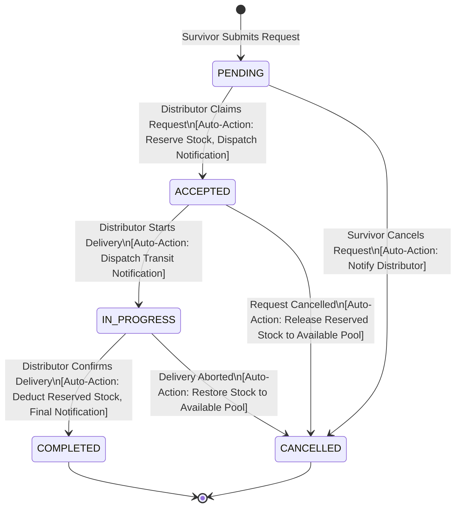

# Phase 5 — Intelligent Automation & State Machine Engineering

**Project**: Relief Distribution System (`com.example.reliefdistribution`)  
**Package**: `com.example.reliefdistribution.data.automation`  
**Phase**: 5 of 10  
**Date**: 2026-11-09  
**Status**: ACTIVE  

---

## 1. Automation Architecture & State Machine

In emergency disaster relief logistics, manual updates lead to race conditions, inventory double-allocation, and lost communication with survivors. The **Relief Workflow Automation Engine** ([`ReliefWorkflowAutomator.java`](file:///H:/Projects/Relief-Distribution/app/src/main/java/com/example/reliefdistribution/data/automation/ReliefWorkflowAutomator.java)) provides automated state management and inventory synchronization.

---

## 2. Event Triggers & Automated Actions

| Trigger Event | Precondition Verification | Automated System Action | Generated Notification |
| :--- | :--- | :--- | :--- |
| **Distributor Claims Request** | `status == PENDING` and `availableStock >= requestQty` | 1. Transitions status to `ACCEPTED` 2. Sets `distributorId` 3. `availableStock -= requestQty` 4. `reservedStock += requestQty` | `TYPE_REQUEST_ACCEPTED` to survivor with distributor identity |
| **Distributor Initiates Transit** | `status == ACCEPTED` | 1. Transitions status to `IN_PROGRESS` 2. Updates `updatedAt` timestamp | `TYPE_REQUEST_IN_PROGRESS` informing survivor supplies are en route |
| **Delivery Handover Confirmed** | `status == IN_PROGRESS` | 1. Transitions status to `COMPLETED` 2. `reservedStock -= requestQty` 3. Closes order lifecycle | `TYPE_REQUEST_COMPLETED` confirming successful delivery |
| **Request Cancelled** | `status != COMPLETED` and `status != CANCELLED` | 1. Transitions status to `CANCELLED` 2. Restores `reservedStock` to `availableStock` | `TYPE_REQUEST_CANCELLED` dispatched to survivor and distributor |
| **Stock Level Breaches Threshold** | `availableStock <= threshold` | 1. Detects low supply at warehouse depot 2. Flags item in inventory dashboard | `TYPE_INVENTORY_LOW` warning dispatched to depot distributor |

---

## 3. Concurrency & Race-Condition Defenses

1. **Atomic Invariant Checks**: Before reserving inventory, `availableQuantity >= requestedQuantity` is validated. If another distributor claimed the last batch moments prior, the automation safely rejects the second claim with an informative error message.
2. **Idempotent Notification Keys**: Notifications are authored with unique UUIDs (`UUID.randomUUID().toString()`) preventing duplicate writes if network timeouts trigger a client-side retry.
3. **Rollback on Cancellation**: If an in-progress delivery cannot be completed due to flood barriers or blocked roads, cancelling the request restores the reserved supplies back to the available inventory pool immediately.

---

## 4. Automated Test Verification

All automation paths are validated via [`ReliefWorkflowAutomatorTest.java`](file:///H:/Projects/Relief-Distribution/app/src/test/java/com/example/reliefdistribution/ReliefWorkflowAutomatorTest.java):
- `onDistributorAcceptRequest_sufficientStock_reservesInventoryAndNotifies`: **PASS**
- `onDistributorAcceptRequest_insufficientStock_failsGracefully`: **PASS**
- `onStartDelivery_fromAcceptedState_succeeds`: **PASS**
- `onDeliveryCompleted_deductsReservedStockAndNotifies`: **PASS**
- `onRequestCancelled_restoresReservedStockToAvailable`: **PASS**
- `checkInventoryThreshold_triggersAlertWhenAtOrBelowThreshold`: **PASS**
