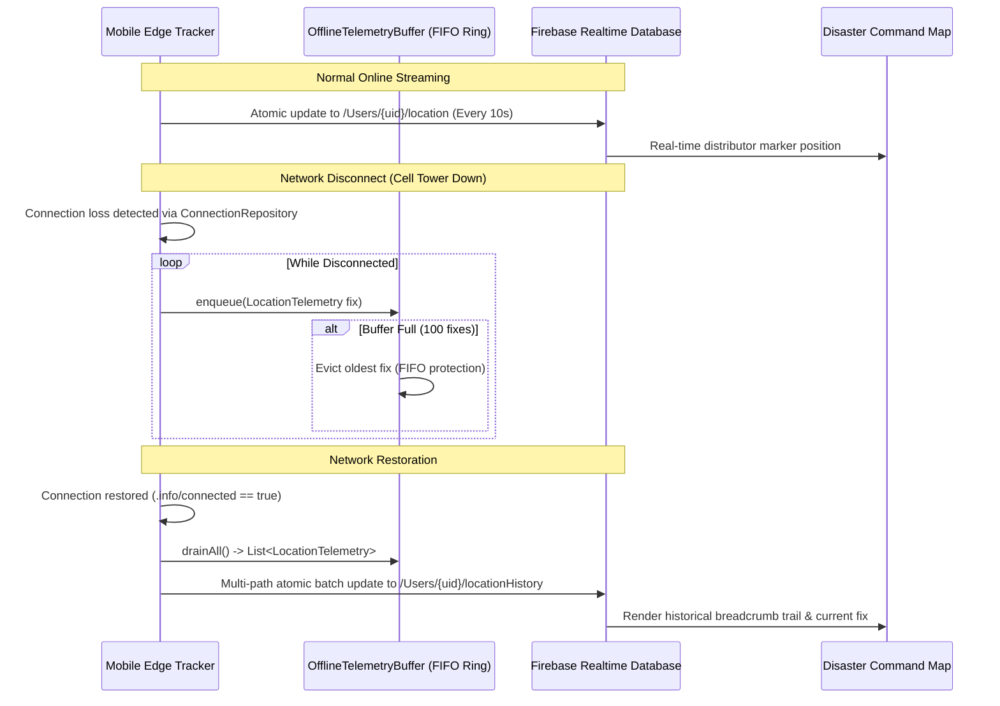

# Phase 5 — IoT Enhancements & Mobile Edge Telemetry Resilience

**Project**: Relief Distribution System (`com.example.reliefdistribution`)  
**Package**: `com.example.reliefdistribution.data.iot`  
**Phase**: 5 of 10  
**Date**: 2026-11-09  
**Status**: ACTIVE  

---

## 1. Mobile Device as a Disaster Edge Node

In humanitarian crisis zones, relief vehicles and field dispatchers operate in extreme environments characterized by intermittent or severed cellular infrastructure. Handheld mobile devices function as distributed edge IoT tracking beacons broadcasting GPS telemetry to the Firebase Cloud Realtime Database.



---

## 2. Bounded Ring Buffer & Memory Safety

To prevent mobile memory exhaustion during extended outages (e.g. 6 hours without signal), the [`OfflineTelemetryBuffer.java`](file:///H:/Projects/Relief-Distribution/app/src/main/java/com/example/reliefdistribution/data/iot/OfflineTelemetryBuffer.java) enforces a bounded FIFO ring buffer:
- **Maximum Capacity**: 100 telemetry fixes ($100 \times 64\text{ bytes} \approx 6.4\text{ KB}$ heap footprint).
- **Eviction Invariant**: When capacity is exceeded, the oldest coordinate sample is evicted (`buffer.pollFirst()`), retaining the most recent 100 historical breadcrumbs.
- **Thread Safety**: All operations (`enqueue`, `drainAll`, `snapshot`) are synchronized for concurrent access between background GPS threads and foreground synchronization workers.

---

## 3. Battery-Aware Adaptive Polling

Disaster field teams often operate without power access for 24–48 hours. Continuous high-accuracy GPS sampling rapidly drains mobile batteries. The IoT engine implements dynamic interval scaling based on real-time velocity and device battery status:

| Operational State | Velocity / Condition | Sampling Interval | Power Consumption |
| :--- | :--- | :--- | :--- |
| **Battery Saver Mode** | Low Battery (< 20% or battery saver active) | **30,000 ms** (30s) | Extremely Low |
| **Stationary Edge Node** | Velocity $< 0.5\text{ m/s}$ (Resting / In Depot) | **20,000 ms** (20s) | Low |
| **Active Field Transit** | $0.5\text{ m/s} \le \text{Velocity} < 10.0\text{ m/s}$ (Walking/Slow Vehicle) | **10,000 ms** (10s) | Moderate |
| **High-Speed Evacuation** | Velocity $\ge 10.0\text{ m/s}$ ($\ge 36\text{ km/h}$) | **5,000 ms** (5s) | High (Momentary) |

Formula implemented in `OfflineTelemetryBuffer.getRecommendedSamplingInterval(float speed, boolean isBatteryLow)`.

---

## 4. Atomic Multi-Path Synchronization

Upon reconnection, buffered breadcrumbs are transformed into a single Firebase multi-path atomic update map:

```java
Map<String, Object> batchMap = OfflineTelemetryBuffer.toFirebaseBatchUpdate(userId, bufferedList);
databaseReference.updateChildren(batchMap);
```

This ensures that hundreds of breadcrumb coordinates are delivered in a single HTTP payload rather than hundreds of individual socket transactions, drastically conserving mobile radio energy and reducing network overhead.

---

## 5. Automated Unit Verification

Validated via [`OfflineTelemetryBufferTest.java`](file:///H:/Projects/Relief-Distribution/app/src/test/java/com/example/reliefdistribution/OfflineTelemetryBufferTest.java):
- `enqueueAndDrain_preservesOrderAndClearsBuffer`: **PASS**
- `ringBufferEviction_dropsOldestWhenCapacityExceeded`: **PASS**
- `toFirebaseBatchUpdate_producesCorrectAtomicPaths`: **PASS**
- `getRecommendedSamplingInterval_adaptsToSpeedAndBattery`: **PASS**
