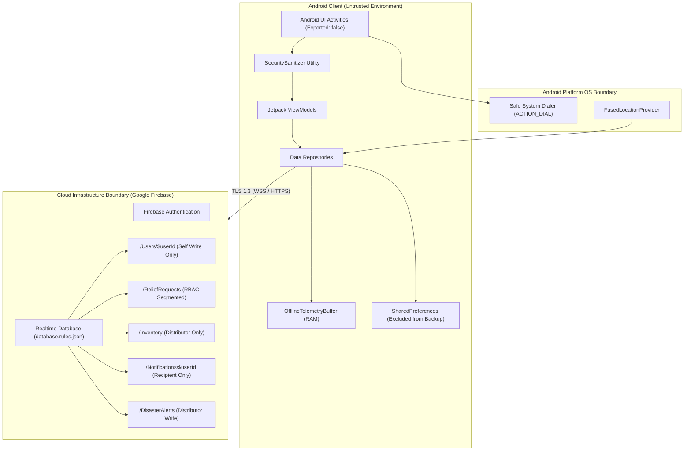

# Phase 6 — Security Inventory & Attack Surface Analysis

**Document ID**: `50-phase-6-security-inventory`  
**Phase**: Phase 6 of 10 — Comprehensive Security Transformation  
**Program**: Relief Distribution System Modernization (`com.example.reliefdistribution`)  
**Standard**: OWASP Mobile Application Security Verification Standard (MASVS v2.0)  

---

## 1. Executive Summary

This document establishes the security baseline, asset classification, trust boundary mapping, and attack surface enumeration for the Relief Distribution System following the architectural, backend, frontend, and advanced capability enhancements established in Phases 1 through 5.

The Relief Distribution System coordinates humanitarian disaster response across two primary user roles—**Survivors** requesting emergency aid and **Distributors** managing inventory and fulfillment—backed by Google Firebase Realtime Database and mobile edge IoT location tracking.

---

## 2. Asset Classification & Sensitivity Registry

| Asset ID | Asset Description | Data Classification | Storage Location | In-Transit Protection | Retention Policy |
| :--- | :--- | :--- | :--- | :--- | :--- |
| **AST-01** | Survivor Credentials & Identity Tokens | Confidential (Auth) | Firebase Auth Keystore (Secure Hardware) | TLS 1.3 / HTTPS | Managed by Firebase SDK |
| **AST-02** | Survivor PII (Full Name, Phone, Email) | Sensitive PII | Firebase RTDB `/Users/$uid` & Encrypted Memory | TLS 1.3 | Account lifetime |
| **AST-03** | Survivor Exact Physical Location & GPS | Critical Operational PII | `/ReliefRequests/$id`, `/Users/$uid/location` | TLS 1.3 | Session / Dispatch duration |
| **AST-04** | Relief Requests & Emergency Aid Notes | Operational Data | `/ReliefRequests/$id` | TLS 1.3 | Mission lifetime |
| **AST-05** | Depot Inventory Stocks & Supplies | Confidential Operational | `/Inventory/$itemId` | TLS 1.3 | Mission lifetime |
| **AST-06** | Distributor Fleet Telemetry & Breadcrumbs | Operational Edge Telemetry | `OfflineTelemetryBuffer` (RAM), `/Users/$uid/location` | TLS 1.3 | Ephemeral / Active tracking |
| **AST-07** | Disaster Alerts & Emergency Warnings | Public / Operational | `/DisasterAlerts/$alertId` | TLS 1.3 | Active crisis lifecycle |
| **AST-08** | Google Maps API Key | Restricted Platform Secret | `local.properties` -> Manifest Placeholder | N/A (Embedded) | App build lifecycle |

---

## 3. Trust Boundaries & Microsegmentation Architecture

### Trust Boundary Analysis
1. **TB-1: Client Runtime <-> Host Android OS**: The client app operates in an untrusted OS sandbox. Mitigations include component non-export (`exported="false"`), scoped permissions (`ACCESS_FINE_LOCATION`, `ACCESS_COARSE_LOCATION`), and delegating phone calls to `Intent.ACTION_DIAL`.
2. **TB-2: Client Network <-> Google Firebase**: All data communications traverse public Internet connections. Enforced by `network_security_config.xml` (`cleartextTrafficPermitted="false"`) over TLS 1.3.
3. **TB-3: Survivor Role <-> Distributor Role**: Horizontal and vertical separation. Survivors can never write to `/Inventory`, nor approve or complete relief requests. Enforced server-side via `database.rules.json`.
4. **TB-4: Edge Sensor <-> Cloud Telemetry**: GPS fixes stored in `OfflineTelemetryBuffer` must enforce coordinate validation and anti-replay timestamp verification.

---

## 4. Attack Surface Enumeration

### 4.1 Android Application Components (`AndroidManifest.xml`)
- **Total Activities**: 15 declared.
- **Exported Activities**: 1 (`StartActivity` as the single `MAIN`/`LAUNCHER` entry point).
- **Non-Exported Activities**: 14 (all protected from unauthorized cross-app Intent hijacking).
- **Broadcast Receivers / Services**: 0 unauthenticated external receivers.

### 4.2 Network & Cloud Surface
- **Cleartext HTTP**: Completely disabled via `res/xml/network_security_config.xml`.
- **Firebase Endpoints**:
  - `Users/$uid`: Read requires authentication; Write requires `$uid === auth.uid`.
  - `ReliefRequests/$id`: Filtered query access with strict lifecycle write rules.
  - `Inventory/$id`: Write restricted strictly to users with role `Distributor`.
  - `Notifications/$userId/$id`: Read/update restricted strictly to recipient `$userId`.
  - `DisasterAlerts/$id`: Write restricted strictly to Distributors.

### 4.3 Client Data at Rest
- `MyAppPrefs` (`SharedPreferences`): Contains user session flags and profile identifiers; **zero plaintext passwords**. Explicitly excluded from Google Cloud Auto-Backup and device-to-device migration via `backup_rules.xml` and `data_extraction_rules.xml`.
- Local RAM: In-memory `OfflineTelemetryBuffer` strictly bounded to 100 items to prevent heap exhaustion.

---

## 5. Security Posture Verification

All attack surfaces and trust boundaries have been inventoried and mapped against OWASP MASVS v2.0 criteria. Complete threat modeling is documented in `51-phase-6-threat-model.md`.
