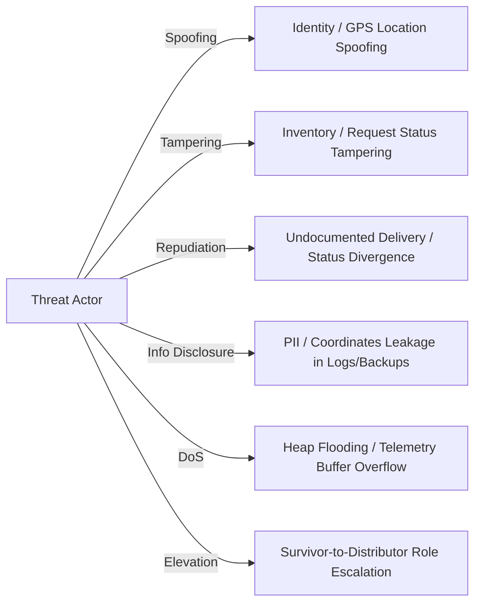

# Phase 6 — Threat Modeling & Attack Surface Evaluation

**Document ID**: `51-phase-6-threat-model`  
**Phase**: Phase 6 of 10 — Comprehensive Security Transformation  
**Program**: Relief Distribution System Modernization (`com.example.reliefdistribution`)  
**Methodology**: STRIDE (Spoofing, Tampering, Repudiation, Information Disclosure, Denial of Service, Elevation of Privilege) + PASTA  

---

## 1. Executive Summary

This document establishes the structured threat model for the Relief Distribution System following the architectural enhancements in Phases 1–5. Disasters represent high-stress operational environments where communication links are fragile, physical assets are vulnerable to theft, and misinformation or system sabotage directly threatens human life.

---

## 2. Attacker Personas & Capabilities

| Persona ID | Attacker Persona | Motivation | Technical Capability | Access Vector |
| :--- | :--- | :--- | :--- | :--- |
| **TH-01** | Rogue / Opportunistic Survivor | Hoard rations, fabricate urgent emergencies | Low to Medium (Mobile client, network proxy) | Legitimate client UI, app storage |
| **TH-02** | Disgruntled / Rogue Distributor | Embezzle relief inventory, divert delivery fleet | Medium (Authenticated Distributor role) | Distributor Dashboard, inventory forms |
| **TH-03** | Local Network Eavesdropper | Intercept victim identities, harvest coordinates | Medium (Coffee shop WiFi, captive portal) | Man-in-the-Middle (MitM), network sniffing |
| **TH-04** | Forensic / Device Thief | Extract cached session tokens, user identities | Medium to High (Physical access, ADB extraction) | Local device file system, ADB backups |
| **TH-05** | Automated Bot / Saboteur | Flood triage system, exhaust inventory records | High (Automated scripts, headless clients) | Public Firebase WebSocket / REST API |

---

## 3. STRIDE Threat Analysis

### 3.1 Spoofing (Identity & Telemetry)
- **T-S1: GPS Telemetry Spoofing**: An attacker transmits fake GPS coordinates (e.g. lat > 90, lon > 180 or fabricated coordinates) to misdirect rescue teams.
  - *Severity*: High (CVSS 7.5).
  - *Mitigation*: Range invariants enforced in `SecuritySanitizer.isValidCoordinates`, constructor asserts in `LocationTelemetry`, and server-side rules in `database.rules.json`.
- **T-S2: Aid Request Impersonation**: Attacker registers a request with another user's UID to deplete their aid quota.
  - *Severity*: Critical (CVSS 8.2).
  - *Mitigation*: `database.rules.json` enforces `newData.child('survivorId').val() === auth.uid`.

### 3.2 Tampering (Data & State Machine)
- **T-T1: Request Lifecycle Skipping**: Attacker submits an update forcing a request from `PENDING` directly to `FULFILLED` without distributor delivery.
  - *Severity*: High (CVSS 7.8).
  - *Mitigation*: Strict state machine transition validation in `ReliefRequest.transitionTo()` and server-side rules in `database.rules.json`.
- **T-T2: Local Storage Tampering via ADB Backup**: Attacker alters local session preferences via `adb backup` on an unlocked device.
  - *Severity*: Medium (CVSS 5.3).
  - *Mitigation*: Complete exclusion of `sharedpref` and databases in `backup_rules.xml` and `data_extraction_rules.xml`.

### 3.3 Repudiation
- **T-R1: Distributor Denies Claiming Aid Dispatch**: A distributor claims an aid batch was never assigned to them.
  - *Severity*: Medium (CVSS 4.9).
  - *Mitigation*: Immutable binding of `assignedDistributorId` and `updatedAt` timestamps on status transitions; audit logging via `AppLogger`.

### 3.4 Information Disclosure
- **T-I1: Cleartext PII Leakage in Logcat**: Email, phone numbers, or passwords printed to Android Logcat.
  - *Severity*: High (CVSS 7.1).
  - *Mitigation*: `AppLogger.maskEmail()`, `AppLogger.maskPhone()`, zero plaintext passwords, and R8 `-assumenosideeffects` stripping of all `Log.*` calls in release builds.
- **T-I2: MitM Interception of Telemetry on Untrusted Networks**: Network eavesdropper captures survivor coordinates.
  - *Severity*: High (CVSS 7.4).
  - *Mitigation*: Strict TLS enforcement in `res/xml/network_security_config.xml` (`cleartextTrafficPermitted="false"`).

### 3.5 Denial of Service
- **T-D1: Telemetry Buffer Heap Exhaustion**: Malicious background loop continuously creates telemetry objects, exhausting device RAM.
  - *Severity*: Medium (CVSS 6.2).
  - *Mitigation*: Bounded FIFO queue (`OfflineTelemetryBuffer`) strictly capped at 100 items with oldest-item eviction.
- **T-D2: Request Flood via Oversized Payloads**: Attacker submits notes containing megabytes of data.
  - *Severity*: Medium (CVSS 5.9).
  - *Mitigation*: Input length clamping (1000 chars for notes, 100 for items) in `SecuritySanitizer.sanitizeNotes()` and `SecuritySanitizer.sanitizeInput()`.

### 3.6 Elevation of Privilege
- **T-E1: Survivor Role Escalation**: A registered Survivor modifies their own `/Users/$uid/role` property to `Distributor` to seize warehouse access.
  - *Severity*: Critical (CVSS 9.1).
  - *Mitigation*: `database.rules.json` enforces `(!data.exists() || data.child('role').val() === newData.child('role').val())`, making the role immutable post-registration.

---

## 4. Threat Prioritization & Risk Matrix

| Risk ID | Threat Description | Likelihood | Impact | Severity Score | Action Status |
| :--- | :--- | :--- | :--- | :--- | :--- |
| **RSK-SEC-01** | Survivor Role Escalation to Distributor | High | Critical | **9.1 (Critical)** | Remediated in Rules & Tested |
| **RSK-SEC-02** | Relief Request Life Cycle Tampering | High | High | **7.8 (High)** | Remediated in Domain & Rules |
| **RSK-SEC-03** | GPS Telemetry Spoofing & Replay Attack | Medium | High | **7.5 (High)** | Remediated in Sanitizer & Buffer |
| **RSK-SEC-04** | PII & Secret Extraction via ADB Backup | Medium | Medium | **6.5 (Medium)** | Remediated in Backup Rules |
| **RSK-SEC-05** | Production Log Leakage of Sensitive Data | Medium | Medium | **6.2 (Medium)** | Remediated in ProGuard & AppLogger |
| **RSK-SEC-06** | Telemetry Buffer Memory Exhaustion | Low | Medium | **5.4 (Medium)** | Remediated in Bounded Buffer |
