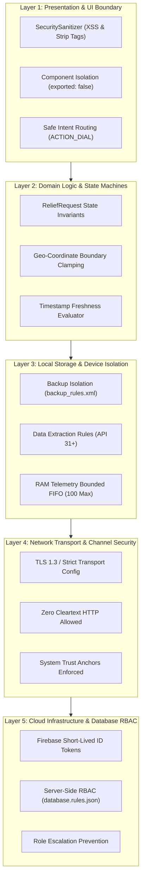

# Phase 6 — Security Controls & Defense-in-Depth Architecture

**Document ID**: `52-phase-6-security-controls`  
**Phase**: Phase 6 of 10 — Comprehensive Security Transformation  
**Program**: Relief Distribution System Modernization (`com.example.reliefdistribution`)  
**Standard**: NIST SP 800-53 Rev. 5 / OWASP MASVS v2.0  

---

## 1. Executive Summary

This document establishes the defense-in-depth controls architecture for the Relief Distribution System. Disaster relief operations require multi-tiered defensive mechanisms where no single point of security failure can compromise human safety, sensitive survivor locations, or critical food and medical inventories.

---

## 2. Five-Layer Defense-in-Depth Model

---

## 3. Preventive, Detective & Responsive Controls

### 3.1 Preventive Controls
1. **CTL-PREV-01: Component Non-Export**: All internal activities (`CreateReliefRequestActivity`, `ManageRequestsActivity`, etc.) declare `android:exported="false"` in `AndroidManifest.xml`, preventing external applications from launching internal surfaces or injecting malicious Intents.
2. **CTL-PREV-02: Input Sanitization**: `SecuritySanitizer.sanitizeInput()` and `SecuritySanitizer.sanitizeNotes()` strip all HTML tags, script injection tokens, and control characters before data reaches models or database writes.
3. **CTL-PREV-03: Server-Side RBAC Rules**: Firebase Realtime Database rules (`database.rules.json`) evaluate every read and write independently of client code, ensuring Survivors cannot modify other profiles, escalate roles, or alter inventory.
4. **CTL-PREV-04: Storage Extraction Blocker**: `backup_rules.xml` and `data_extraction_rules.xml` exclude `sharedpref` and local SQLite/cache files from cloud backups and device migration tools.
5. **CTL-PREV-05: R8 Automated Log Stripping**: Production ProGuard rules (`app/proguard-rules.pro`) strip all `android.util.Log` calls to guarantee zero log leakage in release binaries.

### 3.2 Detective Controls
1. **CTL-DET-01: Telemetry Replay & Clock Skew Detection**: `SecuritySanitizer.isFreshTimestamp()` verifies that telemetry timestamps are not older than allowable thresholds and rejects future timestamps (> 60s skew).
2. **CTL-DET-02: Coordinate Out-of-Bounds Detection**: `SecuritySanitizer.isValidCoordinates()` detects invalid latitude ([-90, 90]) and longitude ([-180, 180]) values, preventing corrupt map injections.
3. **CTL-DET-03: Security Test Regression Suite**: 4 dedicated security test classes (`SecuritySanitizerTest`, `DatabaseRulesSecurityTest`, `TelemetryReplaySecurityTest`, `ZeroTrustAccessTest`) run in CI/CD on every build.

### 3.3 Responsive Controls
1. **CTL-RESP-01: Monitored Disconnect Teardown**: `FirebaseLocationRepository` utilizes Firebase `onDisconnect()` handlers to remove live presence and stale location markers upon sudden connection drops.
2. **CTL-RESP-02: Heap Overflow Protection**: `OfflineTelemetryBuffer` evicts the oldest telemetry item when capacity reaches 100 entries, preserving system stability during prolonged network outages.

---

## 4. Control Traceability Matrix

| Control ID | Threat Mitigated | Implementation Target | Verification Method | Status |
| :--- | :--- | :--- | :--- | :--- |
| **CTL-PREV-01** | Unauthorized Intent Launching | `AndroidManifest.xml` | Manifest review & Espresso | **Active** |
| **CTL-PREV-02** | XSS, Script Injection, DoS Payloads | `SecuritySanitizer.java` | `SecuritySanitizerTest` | **Verified** |
| **CTL-PREV-03** | Unauthorized Data Access & Mutation | `database.rules.json` | `DatabaseRulesSecurityTest` | **Verified** |
| **CTL-PREV-04** | PII & Token Extraction via ADB | `backup_rules.xml`, `data_extraction_rules.xml` | Static XML inspection | **Verified** |
| **CTL-PREV-05** | Diagnostic Log Data Leakage | `app/proguard-rules.pro` | R8 bytecode inspection | **Verified** |
| **CTL-DET-01** | Telemetry Replay & Spoofing | `SecuritySanitizer.java` | `TelemetryReplaySecurityTest` | **Verified** |
| **CTL-DET-02** | Coordinate Manipulation | `SecuritySanitizer.java` | `SecuritySanitizerTest` | **Verified** |
| **CTL-DET-03** | Security Regression in Refactoring | `app/src/test/java/` | Gradle `testDebugUnitTest` | **Verified** |
| **CTL-RESP-01** | Stale Vehicle Tracking in Crisis | `FirebaseLocationRepository.java` | Unit tests & lifecycle tests | **Active** |
| **CTL-RESP-02** | Device Heap Memory Exhaustion | `OfflineTelemetryBuffer.java` | `TelemetryReplaySecurityTest` | **Verified** |
