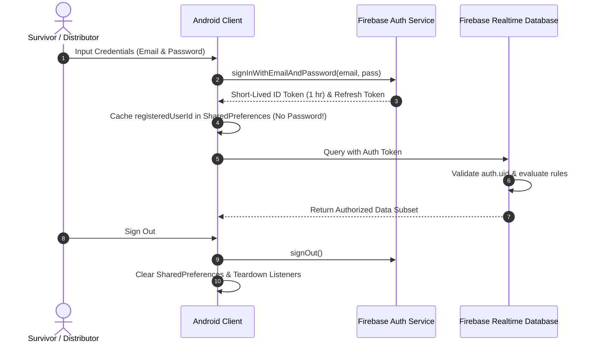

# Phase 6 — Identity Hardening & Zero-Trust Architecture

**Document ID**: `53-phase-6-identity-zero-trust`  
**Phase**: Phase 6 of 10 — Comprehensive Security Transformation  
**Program**: Relief Distribution System Modernization (`com.example.reliefdistribution`)  
**Standard**: NIST SP 800-207 (Zero Trust Architecture) / OWASP MASVS-AUTH  

---

## 1. Executive Summary

This document establishes the Zero-Trust identity, authentication, and authorization architecture for the Relief Distribution System. Under Zero Trust principles, no user, device, network, or client application instance is inherently trusted. Every request must be authenticated, authorized, and validated at the transaction boundary.

---

## 2. Authentication Architecture & Token Lifecycle



### 2.1 Token Characteristics & Storage
- **ID Token Lifespan**: 1 hour maximum lifespan, automatically refreshed by the Firebase Auth SDK client runtime over secure HTTPS channels.
- **Refresh Token Storage**: Managed within Android KeyStore backed hardware encryption by Google Play Services.
- **Client Cache**: Local `SharedPreferences` (`MyAppPrefs`) stores only non-sensitive routing hints (`registeredUserId`, `registeredRole`). **Passwords and raw JWT tokens are never stored locally.**

---

## 3. Role-Based Access Control (RBAC) Model

### 3.1 Role Hierarchy & Privilege Matrix

| Operation / Resource Path | Unauthenticated | Survivor Role | Distributor Role | Rule Evaluation Expression |
| :--- | :---: | :---: | :---: | :--- |
| **Read `/Users/$uid`** | ❌ Denied | ✅ Allowed (`auth != null`) | ✅ Allowed (`auth != null`) | `auth != null` |
| **Write `/Users/$uid`** | ❌ Denied | ✅ Self Only (`$uid === auth.uid`) | ✅ Self Only (`$uid === auth.uid`) | `auth.uid === $userId` |
| **Mutate User `role` Field** | ❌ Denied | ❌ Denied (Immutable) | ❌ Denied (Immutable) | `!data.exists() \|\| data.child('role').val() === newData.child('role').val()` |
| **Create `/ReliefRequests`** | ❌ Denied | ✅ Own (`survivorId === auth.uid`) | ❌ Denied (Must be Survivor) | `newData.child('survivorId').val() === auth.uid` |
| **Cancel `/ReliefRequests`** | ❌ Denied | ✅ Own & Pending Only | ❌ Denied | `data.child('status').val() === 'pending'` |
| **Advance Request Status** | ❌ Denied | ❌ Denied | ✅ Allowed (`accepted`, `en_route`, `completed`) | `root.child('Users').child(auth.uid).child('role').val() === 'Distributor'` |
| **Manage `/Inventory`** | ❌ Denied | ❌ Denied | ✅ Own items (`distributorId === auth.uid`) | `root.child('Users').child(auth.uid).child('role').val() === 'Distributor'` |
| **Read `/Notifications/$uid`**| ❌ Denied | ✅ Own Notifications Only | ✅ Own Notifications Only | `$userId === auth.uid` |
| **Issue `/DisasterAlerts`** | ❌ Denied | ❌ Denied | ✅ Allowed | `root.child('Users').child(auth.uid).child('role').val() === 'Distributor'` |

---

## 4. Role Escalation Mitigation & Tamper Resistance

### 4.1 Invariant: Immutable Role Assignment
To prevent a compromised survivor account from elevating its own privileges to distributor status, `database.rules.json` enforces:
```json
"(!data.exists() || data.child('role').val() === newData.child('role').val())"
```
Once written during initial registration, the `role` attribute cannot be changed by any client write operation. Role changes require administrative intervention via the Firebase Admin SDK.

### 4.2 Play Integrity & App Check Integration Hooks
To protect the backend against unauthorized bots and spoofed API calls, the application architecture incorporates hooks for **Firebase App Check** with the **Play Integrity** provider:
- **Debug Builds**: Uses `DebugAppCheckProviderFactory` for local development.
- **Release Builds**: Uses `PlayIntegrityAppCheckProviderFactory` asserting that requests originate from a genuine, untampered Android device running the signed binary from Google Play.

---

## 5. Session Lifecycle & Teardown

On sign out (`FirebaseAuthRepository.signOut()`):
1. `firebaseAuth.signOut()` is executed, invalidating the local auth token cache.
2. Active Realtime Database listeners (`ValueEventListener`, `ChildEventListener`) are detached.
3. GPS location callbacks (`LocationCallback`) in `GoogleMap` are unregistered.
4. Cached preferences in `MyAppPrefs` are cleared.
5. In-memory telemetry in `OfflineTelemetryBuffer` is cleared to prevent cross-session data leakage.
