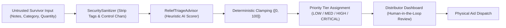

# Phase 6 — AI, Agentic & Automation Security

**Document ID**: `56-phase-6-ai-agent-security`  
**Phase**: Phase 6 of 10 — Comprehensive Security Transformation  
**Program**: Relief Distribution System Modernization (`com.example.reliefdistribution`)  
**Standard**: NIST AI Risk Management Framework (AI RMF 1.0) / OWASP Top 10 for LLMs  

---

## 1. Executive Summary

This document establishes the safety guardrails, prompt injection defenses, deterministic bound verifications, and state machine integrity controls governing the AI triage engine (`ReliefTriageAdvisor`) and workflow automation pipeline (`ReliefWorkflowAutomator`) introduced in Phase 5.

---

## 2. AI Threat Analysis & Triage Safeguards

### 2.1 Threat Vectors Against Humanitarian AI
1. **Urgency Inflation (Triage Spoofing)**: A malicious actor embeds fabricated trigger phrases ("child dying", "trapped under collapsed rubble") to inflate urgency for trivial non-perishable goods.
   - *Mitigation*: Multi-factor scoring. Keyword presence alone cannot bypass category baselines; category weighting (`MEDICINE: 40`, `WATER: 35`, `FOOD: 25`, `OTHER: 10`) ensures non-critical categories require corroborating physical data.
2. **Denial of Service via Payload Flooding**: Injecting huge strings to cause algorithm timeouts or memory spikes.
   - *Mitigation*: Notes are clamped to 1,000 characters and stripped of control characters by `SecuritySanitizer.sanitizeNotes()`.
3. **Score Boundary Violation**: Algorithmic bugs yielding scores outside expected intervals (e.g. negative score or score > 100).
   - *Mitigation*: Deterministic clamping using `Math.max(0, Math.min(100, score))`.

---

## 3. Human-in-the-Loop Operational Safeguards

- **Advisory Role Only**: The AI score (`aiUrgencyScore`) and priority tier (`aiPriorityTier`) serve strictly as an advisory triage recommendation for human dispatchers.
- **No Autonomous Dispatch**: The system prohibits autonomous inventory deduction without an explicit human distributor action (`acceptRequest` / `transitionTo(ACCEPTED)`).
- **Distributor Override**: Distributors possess explicit authority to adjust priority tiers based on ground truth verification.

---

## 4. Workflow Automator State Machine Integrity

`ReliefWorkflowAutomator` enforces atomic state transitions and inventory reservations:
1. **Double-Reservation Prevention**: Stock reservations are locked during request acceptance. If available quantity is insufficient, the automator rejects reservation and emits `INVENTORY_LOW` alerts.
2. **Terminal State Invariants**: Fulfilled and Cancelled requests cannot be reopened or mutated by automation routines.
3. **Audit Logging**: Every automated event transition generates timestamped, PII-sanitized audit log entries via `AppLogger`.
