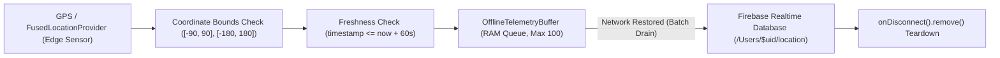

# Phase 6 — IoT & Mobile Edge Telemetry Security

**Document ID**: `58-phase-6-iot-firmware-security`  
**Phase**: Phase 6 of 10 — Comprehensive Security Transformation  
**Program**: Relief Distribution System Modernization (`com.example.reliefdistribution`)  
**Standard**: ETSI EN 303 645 (Cyber Security for Consumer IoT) / NIST IR 8259  

---

## 1. Executive Summary

In humanitarian disaster operations, field distributor vehicles and survivor beacons function as mobile edge IoT sensor nodes streaming real-time geographic telemetry. This document details the telemetry anti-spoofing, replay attack mitigation, timestamp freshness validation, and memory exhaustion defenses implemented in Phase 6.

---

## 2. Mobile Edge Sensor Pipeline Architecture

---

## 3. Defense Mechanisms Against Edge Telemetry Threats

### 3.1 Geographic Coordinate Spoofing
- **Threat**: Compromised handsets or mock location apps injecting invalid or extreme coordinates (e.g. lat: 95.0, lon: 200.0) causing client rendering crashes or incorrect fleet tracking.
- **Defense**:
  1. `SecuritySanitizer.isValidCoordinates()` validates that latitude is strictly within `[-90.0, 90.0]` and longitude within `[-180.0, 180.0]`.
  2. `LocationTelemetry` constructor throws `IllegalArgumentException` on invalid coordinates.
  3. `database.rules.json` enforces numeric boundary checks on `/Users/$userId/location` sub-nodes.

### 3.2 Telemetry Replay Attacks
- **Threat**: An attacker sniffs an offline telemetry batch and resends it hours later to simulate active aid distribution or vehicle presence in an area that has already been evacuated.
- **Defense**:
  1. `SecuritySanitizer.isFreshTimestamp()` evaluates timestamp age against a maximum allowable freshness window (e.g. 1 hour for live tracking, 24 hours for offline batch sync).
  2. Future clock skew is capped at 60,000 milliseconds to reject forward-dated packets.

### 3.3 Buffer Exhaustion & Memory Exhaustion DoS
- **Threat**: Extended connectivity loss causing continuous location polling to exhaust mobile device RAM.
- **Defense**:
  1. `OfflineTelemetryBuffer` enforces a strict capacity ceiling (default: 100 items).
  2. When the buffer is full, older telemetry fixes are evicted via `buffer.pollFirst()`, guaranteeing predictable, constant memory consumption.

### 3.4 Disconnect Safety & Stale Telemetry Teardown
- Live tracking presence registers `onDisconnect().remove()` hooks on Firebase RTDB to automatically purge live coordinates if a distributor's device is abruptly destroyed or loses cellular coverage.
